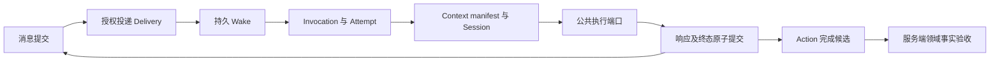

# 持续协作模式实施指导

状态：**实施中**（T01–T11 已交付；T12 接线及所列分层验收完成，真实组合/发布条件未全部通过）。用户已确认产品命名与验收目标；新模式日常生产保持默认关闭，启用需固定发布清单及持久授权。更新：2026-10-22。RC01/进度文档已推送 `35804a1`，RC02实现及所列分层验收已完成，随本次提交交付；剩余工作见[计划表](threaded-collaboration-remaining-plan.md)。

来源：[Issue #16 持续线程协作模式](https://github.com/cat15926/agent-gand/issues/16)，正文更新于 2026-10-19 21:17:35（Asia/Shanghai），提取时无评论。原 Issue 的 K01–K16 合同、T01–T12 任务包和验收 ID 继续有效；本文不改变其语义。

**实施目标是新增“持续协作”模式（内部标识 `threaded`）：成员围绕持续 Thread，通过持久消息和唤醒协作，单次 Invocation 独立结束，业务 Action 由领域事实验收。**复用账号、驱动、工具权限、存储事务、用量和审计；旧 Collaboration 与自主协作继续遵循各自契约。

命名决定（用户已确认，2026-10-19）：产品与界面统一使用“持续协作”，替代原建议名“团队协作”；代码、协议和配置沿用内部标识 `threaded`。名称表达协作空间长期存在、成员上下文持续积累、单次回复或任务结束后仍可继续推进工作。界面说明文案：**与多位 Agent 持续交流、接力执行，共同推进工作。**

验收目标（用户已确认，2026-10-19）：**核心协作规则不做简化，平台差异显式登记，新增可靠性能力单独验收，高级能力逐项说明范围。**具体证据与发布要求见第 8 节。

T01 已交付[设计决策](threaded-collaboration-t01-decisions.md)、[兼容矩阵](threaded-collaboration-compatibility-matrix.md)、[接入地图](threaded-collaboration-integration-map.md)与[基线报告](../reports/threaded-collaboration-t01-baseline-2026-10-19.md)。T02 已完成默认关闭的类型、身份、路由、旧路径隔离与 v25 迁移，见[基础架构合同](../architecture/threaded-foundation-v1.md)和[验收报告](../reports/threaded-collaboration-t02-foundation-2026-10-19.md)。T03 已增加可信 Binding、Run adapter 与生命周期控制，见[执行边界合同](../architecture/threaded-execution-boundary-v1.md)和[验收报告](../reports/threaded-collaboration-t03-execution-2026-10-20.md)。T04 已接入持久共享资源、旧模式兼容桥与 Session 身份准备，见[资源合同](../architecture/threaded-resources-v1.md)和[验收报告](../reports/threaded-collaboration-t04-resources-2026-10-20.md)。T05 已交付独立消息、统一 ACL、附件、冻结 wave 和持久通知，见[消息合同](../architecture/threaded-messaging-v1.md)和[验收报告](../reports/threaded-collaboration-t05-messaging-2026-10-20.md)。T06 已完成持久调度、响应终态与根预算闭环并推送 `79bad41`，见[运行时合同](../architecture/threaded-runtime-v1.md)和[验收报告](../reports/threaded-collaboration-t06-runtime-2026-10-20.md)。

T07 已接通冻结输入 manifest、三类游标、Session 恢复锚点与 API/SDK 后端，见[上下文与后端合同](../architecture/threaded-context-backends-v1.md)和[验收报告](../reports/threaded-collaboration-t07-context-backends-2026-10-20.md)。所列隔离场景与 macOS 真实 API 重建、SDK 原生续接/权限变化冷开/取消 unknown 已通过；同一验收进程内重建 runtime 和 SQLite 连接后的原生恢复补验也通过。T07 已推送 `a773698`。T08 已实现用户/Agent 路由、15 个协作工具、持久征询与非阻塞等待/Decision，见[T08 合同](../architecture/threaded-collaboration-v1.md)和[验收报告](../reports/threaded-collaboration-t08-tools-waits-2026-10-21.md)。T08已推送`606a8c0`。T09已完成独立Thread界面、专用认证、只读投影、精确回执及授权同步，见[T09合同](../architecture/threaded-ui-v1.md)和[验收报告](../reports/threaded-collaboration-t09-ui-2026-10-21.md)。T10/T11已推送 `c944c9d`/`ba438b1`；T12已推送 `b99997a`，新增发布控制、恢复及宿主验收，见[报告](../reports/threaded-collaboration-t12-release-2026-10-21.md)。剩余退出门槛见[实施状态](threaded-collaboration-implementation-status.md)。阶段4是原路线的中间里程碑；现已推进至T12，完整真实组合、生产接线及发布条件的缺口按剩余计划收口。

## 1 T01 固定基线与初始差距

| 对象 | 固定版本或核对结果 |
| --- | --- |
| Issue 的 agent-gand 基线 | `996513c673498811bed894b3eecf64382e71af3f` |
| T01 核对 HEAD | `b95dc2553405268a9b807b3983fee8f9facc55fa` |
| 两者差异 | 一个提交 `fix(chat): separate execution drafts and improve result presentation`，25 个文件，330 行新增、45 行删除 |
| Clowder 参考版本 | `8b373123323aacd7e2047dab94fdc15b8f7567ae`；固定版本，不代表当前远端最新状态 |
| 本地环境 | Node `v22.23.1`，pnpm `9.15.4` |
| T01 迁移清单 | 当时源码最高 v24；T02 已追加 v25，未据此推断日常数据库的实际版本 |
| T01 前新模式实现 | 当时无 `threaded` 实现及 `verify:threaded-*` 脚本；当前已推进至 T12，功能范围与真实验收边界见实施状态 |

新增提交把带控制工具的临时正文标为 `control_draft`，正式消息以提交结果为准，并修复完整交付正文和前端展示。Threaded 复用执行循环时必须保留这些改动，同时明确显式 post、普通最终响应和临时流式输出的边界。参考 [turnDisplay.ts](../../apps/server/src/orchestration/turnDisplay.ts)、[agentStep.ts](../../apps/server/src/orchestration/agentStep.ts)、[事件类型](../../packages/shared/src/events.ts)及[展示回归脚本](../../scripts/verify-message-presentation.mjs)。

T01 核对时，与 Issue 的 agent-gand 基线相比，模式类型、成员锁、会话绑定、终态和启动恢复等核心文件没有变化。T02 已修改类型与旧路径隔离；后续仍须重新记录 HEAD 和未提交修改，不能把 T01 清单当当前源码保证。

## 2 已确定的边界

| 对象 | 职责 | 结束条件 |
| --- | --- | --- |
| Thread | 持续房间、成员、消息和工作关系 | 用户关闭、归档或明确生命周期策略 |
| Invocation | 成员被唤醒后的一次执行；重试保留同一 Invocation，新增 Attempt | 完成、失败、取消或需要对账的 unknown |
| Action | 对指定业务对象及版本承担责任 | 服务端领域验收、合法替换、返回或终止 |

队列暂时为空只表示没有可执行工作。Invocation 结束不自动完成 Action；Action 完成不关闭 Thread；一次失败不永久终结整个房间。

首版一间新模式 Conversation 对应一个 Thread。使用独立产品 mode、HTTP 契约、模型工具契约和存储版本；不占用自主协作的 `entryVersion: 2`，不重解释旧模型协议 v2。活动旧房间不原地切换，迁移历史需显式选择内容并保留授权与来源。

首批延续 SQLite 事务和 WAL。可以为公共执行接口建立短期执行 Run，但 Run 只代表一次执行适配，不能充当永久 Thread，也不能由旧 Run 汇总器决定线程结束。

兼容矩阵分别标记“参考行为”“本地增强”“范围外”“尚未验证”。持久化多成员征询是相对参考版本的增强；Collective 的私有与公共隔离属于后续按发布范围验证的能力。API 后端重建上下文不能标为原生 Session resume。

## 3 必须先处理的代码接入点

本节保留 T01 盘点及总体任务责任，表中的代码事实均为当时基线；T02–T12 已实现部分以对应架构合同与实施状态为准，不表示整行后续能力已经实现。

| 当前事实与源码 | 实施动作 | 对应合同 |
| --- | --- | --- |
| [RunMode](../../packages/shared/src/run.ts) 只有三种；[Conversation](../../packages/shared/src/conversation.ts) 复用该类型；[空房间入口](../../apps/server/src/conversations/entry.ts) 固定创建 collaboration | 增加明确模式及新房间入口，穷尽检查默认分支；明确房间 mode 与执行 Run 的归属 | K01、K16 |
| [ExecutionBinding](../../packages/shared/src/execution.ts) 只有旧的三类来源 | 增加可信 Invocation/Attempt/owner/generation 来源；在执行、工具、回调和取消处再次校验 | K05、K07 |
| [dispatcher](../../apps/server/src/conversations/dispatcher.ts)、[编排入口](../../apps/server/src/orchestration/entry.ts) 和通用控制会按旧模式分派 | 独立 admission 与 lifecycle port；审批后唤醒、账号撤销、暂停、停止与重启均按 mode/origin 分流 | K14、K16 |
| [messages 表](../../apps/server/src/db/schema.sql) 要求 `run_id NOT NULL` | 先决定线程消息存储方案，允许用户与系统消息在无执行 Run 时存在；不虚构长驻 Run | K01、K02 |
| [store.ts](../../apps/server/src/collaboration/store.ts) 按 Agent 排除并发；[memberAdmission.ts](../../apps/server/src/execution/memberAdmission.ts) 有全局 FIFO 与 `member:${agentId}` 租约 | 两层同步适配成混合模式 claim；不能只改租约键 | K05、K06 |
| [sessions.ts](../../apps/server/src/execution/sessions.ts) 默认 turn；conversation 策略也可能带 runId 信息边界 | 复用 Session 校验和锁机制，为 Threaded 建独立稳定绑定策略 | K07–K09 |
| [completion.ts](../../apps/server/src/runtime/completion.ts) 汇总整个 Run；[terminal.ts](../../apps/server/src/runtime/terminal.ts) 要求 accepted completion evaluation | 新增 InvocationTerminalProof 及模式化原子提交；保持旧完成证明的约束 | K01、K03、K11 |
| [scheduler.ts](../../apps/server/src/collaboration/scheduler.ts) 使用旧 Batch aggregate 回流 | 新消息只进入持久 wake；新征询由独立 settlement 管理 | K03、K04、K10 |
| [index.ts](../../apps/server/src/index.ts) 串联多套恢复器；[runs/recovery.ts](../../apps/server/src/runs/recovery.ts) 提供通用恢复 | 逐一声明恢复所有权，先核实外部执行，再恢复资源、队列及领域事件，最后开放派发 | K13、K14 |
| [消息总线](../../apps/server/src/messaging/bus.ts) 与 WebSocket 是通知路径 | 事务内写事实和 outbox；前端先读快照，再补事件，通知丢失仍能恢复 | K02–K04 |

共享底座可继续使用 [账号](../../apps/server/src/accounts/)、[执行驱动](../../apps/server/src/execution/)、[工具账本](../../apps/server/src/tools/executions.ts)、[Trace](../../apps/server/src/runs/trace.ts)和 [Action Command 事务模式](../../apps/server/src/runtime/actionCommands.ts)。复用前检查是否隐含旧 Run、Subject 或终态条件；不要整体复制旧调度器或另建一套账号系统。

实施全量搜索应覆盖 `RunMode`、`ExecutionBinding`、`mode ===`、最终 `else`、Run 终态清理和恢复 SQL。仅补 TypeScript 联合类型不能证明实际分派安全。

T01 确认的隐式回落包括：`conversations/dispatcher.ts` 将非 supervisor 路径交给 pipeline；`runs/recovery.ts` 将非 pipeline/supervisor 路径交给旧 Collaboration；`accounts/actions.ts` 的撤销处理可能回落到 `finishRun`。T03 已处理新模式接线与审批恢复。T04 已补真实 native Session ID 互斥和持久代际，T05 已接 Outbox，T07 已验证 Session 恢复锚点；旧 bindingKey 或无代际 lease 本身仍不能替代这些合同。`afterCommit` 可用于通知，但不代替持久 Outbox。

## 4 T01 已冻结的具体选择

以下为 T01 冻结的实施选择，完整合同、接口和取舍以 [T01 设计决策](threaded-collaboration-t01-decisions.md)为准；实际实现及验证进度以实施状态和各阶段报告为准。

| 决策 | 冻结结果 |
| --- | --- |
| 线程消息落库 | 独立 `threaded_messages`，保持旧 `messages.run_id NOT NULL`；实际消息与执行 Run 解耦，前向增量迁移 |
| Run 与 Attempt 映射 | 一个 Invocation 唯一关联一个执行 Run，重试增加 Attempt 并复用 Run；只有 Invocation 真正终结才结算 Run；unknown 非终态 |
| 可信 owner | 单部署单业务所有者，数据库持久 `instance_owner_id`；管理 cookie 仅作短期认证。专用 Threaded HTTP/WS 鉴权，并隔离旧 HTTP/WS 的派生读取和事件旁路 |
| 首批真实后端 | fake executor 先行；模型 API 与 claude-sdk 0.3.288 为首批 macOS 验收目标，API 重建与 SDK 原生续会话分别报告；Linux 后验，其他载体按矩阵关闭或另验 |
| Thread 与成员控制 | 主状态与控制收敛状态分开；暂停保存消息但不新领执行；关闭撤销并对账；确认关闭才可归档；重开不自动重放旧责任 |
| 等待与调用状态 | hold/Decision 注册后立即返回工具结果，当前 Invocation 正常提交结束，事件产生继承因果根的后继 wake；早到事件等待同槽释放；原生在途审批与 unknown 保留实际执行围栏 |
| Action 权威来源 | `task_done` 使用平台任务合法状态转换；`review_delivered` 使用 GitHub PR 当前 HEAD 与获权评审交付；无真实 producer/resolver/freshness 闭环不启用 |
| 工程工作区 | canonical workspace claim 下串行写，或独立 worktree 并明确合并者/版本；禁止 shell 未声明写入绕过资源约束 |
| 共享容量与预算 | 所有模式统一资源竞争，旧独占屏障和跨 Thread 轮转防饥饿；默认全局/Thread/账号容量 3。因果根默认 20 次 Invocation、30 分钟累计活动执行、300000 输出 tokens、估算 5 USD，未知占额不免费释放；不按 wake 重置 |

后续实现若发现必须调整，登记具体依据、影响合同与验收用例，不能静默改变基线。产品名称“持续协作”、内部模式标识 `threaded` 和四项验收目标继续有效。

## 5 最小持久闭环



### 5.1 三个事务边界

1. **接收入场**：鉴权、策略及幂等内容校验后，在同一事务保存 Message、Delivery、Wake、必要 Outbox；提交后通知 UI 和队列。通知失败由持久扫描补齐。
2. **领取执行**：原子领取 wake、建立 Invocation/Attempt、资源 claim、执行代际和 Run 绑定。先保存 context manifest 与投递意图，执行前复核授权；网络和模型调用在数据库事务外进行。
3. **响应完成**：比较当前 Attempt、owner、fencing token，原子写响应、Invocation 终态、执行 Run、后继 Delivery/Wake 及 Outbox。失败则整体回滚；不能伪造旧 CompletionInput 或借 `finishRun` 绕账本。

显式 `post_message` 是独立提交的消息，即使后续 final 失败也保留。final 再合法点名同一成员时，是另一条 authored message，可有独立 wake；只对同一来源及请求身份去重，不能按相似正文吞掉接力。流式半截 `@` 不触发执行。

### 5.2 最低数据约束

| 实体组 | 必须保存的事实 |
| --- | --- |
| Thread、Member | Conversation 唯一关联、owner、模式与策略版本、成员配置和权限版本 |
| Message、Delivery | 不可变消息 ID、可信 sender、接收人、可见受众、内容 hash、来源 Attempt、因果根；逻辑投递唯一 |
| Wake、Outbox | 路由目的与版本、目标、去重键、状态、可执行时间、领取 owner/generation、重试信息 |
| Invocation、Attempt、Run binding | 原 wake 集映射、当前 Attempt、执行确认阶段、外部执行 ID、输出提交状态、唯一运行关联 |
| Resource claim、Session | 资源类型及冲突范围、所有者、租约代际、原生 Session 锁、配置 hash、权限版本、恢复锚点 |
| Context delivery | 实际输入 ID/版本/hash、授权、裁剪、准备/发送/确认/unknown、对应 Attempt |
| Consultation、Wait、Decision | 目标、首个有效回复、deadline、唯一 settlement、等待条件与版本、持久恢复事件 |
| Action、Evidence | 业务身份、holder、generation、freshness、冻结谓词、替换链、不可变证据及授权来源 |

幂等键至少覆盖用户请求、工具消息、逻辑 wake、响应提交和业务 Action。同键不同正文、目标或 ACL 返回冲突。Action 按业务身份再次去重，不能把新 toolCallId 当成新业务意图。

### 5.3 混合模式资源规则

| 同一 Agent 的两个调用 | 并发规则 |
| --- | --- |
| 旧模式与旧模式 | 保留全局互斥 |
| 旧全局独占与 Threaded | 互斥 |
| Threaded 同一 Thread | 互斥 |
| Threaded 不同 Thread | 可并发，但继续受 Session、账号、全局容量与文件资源限制 |

exclusive claim 和 thread-slot claim 必须在同一原子竞争机制中看到对方；旧独占已排队时防止新线程持续插队。续租、释放、回调提交都比较 owner 与 generation。取消 A 不影响并行 B，旧 A 的 finally 不能释放新 A 的槽。

### 5.4 上下文与恢复

接收人决定唤醒目标，visibility/audience 决定读取范围。公共历史、私密消息、附件、搜索展开、摘要和跨线程引用使用一致授权；成员私有 transcript 不进入公共上下文。并行独立思考使用冻结输入边界，避免后启动成员吸收同波先完成答案。

分开保存平台接收、上下文投递和业务完成；同时区分 `delivery`、`seen`、`mention_ack`。游标只作加速，单条投递账本处理 ACL 空洞、补投和乱序；后端发送结果未知时不能直接前移游标。权限收缩后冷开或用重新授权的摘要重建，会话不能靠关闭 ACL 获得连续性。

恢复顺序为：schema/策略 → 外部进程与未知副作用 → 资源与 Session → Invocation/响应/投递/wake/outbox → 等待/征询/Action → 内存投影 → 新派发。每条记录只有一个模式恢复器负责。

| 故障窗口 | 恢复要求 |
| --- | --- |
| 消息已提交但通知丢失 | 扫描并恢复同一逻辑 wake |
| 已领取且确认未启动外部请求 | 同 Invocation 新 Attempt，按退避与上限重试 |
| 模型或写工具可能已执行，无可靠回执 | unknown 并对账，保留资源与预算约束，不盲重放 |
| 响应、wake 或 Action 终态已提交 | 仅恢复投影和通知，不重新执行或结算 |
| 取消或替换后旧回调到达 | 代际拒绝并留审计；已经发生的外部副作用另行对账 |
| 数据库不可写 | 不承诺接收成功，不用内存队列冒充落盘 |

执行未知与费用未知分别记录。重试、接力、修订和替换继承因果链预算；追加预算形成版本化决策。承诺持久接收、幂等提交和唯一有效所有者，不宣称外部副作用端到端 exactly once。

## 6 协作行为与业务完成

| 能力 | 实施重点 |
| --- | --- |
| 用户路由 | 用户点名、群组、意图标签与 Agent A2A 分策略；preview 和实际准入调用同一政策；fallback 顺序可解释 |
| 文本 A2A | 完成响应后解析行首 handle，排除代码围栏、自身与前缀误匹配；参考上限为两个目标、链深度默认 15；parallel 独立思考的文本提及不接力 |
| `post_message`、`cross_post_message` | sender/owner/scope 来自执行绑定；跨线程校验目标权限，仅发送明确内容和获权附件；结构化目标与文本路由冲突时拒绝 |
| `multi_mention` | 参考 1–3 个目标、默认 8 分钟、范围 3–20 分钟；防级联；每个目标首个有效响应计一次；重复、迟到、超时竞争只有一个 settlement；保留分歧原文 |
| `hold_ball` | 保留责任但释放执行槽；计时 5 秒至 1 小时，滑动一小时同 Thread/Agent 最多三次；同 job 重试不重复扣额。计时到期不代表业务条件已满足；退休 wake 不等于命令已取消 |
| 外部 tracking | 注册时冻结 live baseline 和匹配条件，新事件才产生幂等 wake；不能把历史事件或展示文案当触发谓词 |
| 人类回应 | 对齐非阻塞 ConversationDecision 与 once、settle/withdraw/supersede 版本合同；参考旧 `request_user_input` 已退役。回应问题不自动授予业务批准权限 |
| Action | 按业务身份、standing、holder/generation、freshness 准入；默认一个 successor；并行责任需要明确意图与授权 |
| Review 与 Revision | `review_delivered` 只证明评审交付；changes_requested 仍可完成评审责任，但批准门禁不通过；新 HEAD 必须重新检查版本，作者自报修好不能覆盖独立审查 |
| SOP 与知识 | SOP expectedVersion CAS；attested/verified/unknown 分开。知识保留 anchor、版本、ACL、来源及过期/替代状态；检索结果不授予权限，不自动证明 Action 完成 |

第一批完成谓词限定为真正接通 producer → resolver → freshness → CAS → 恢复通知的 `review_delivered`、`task_done`。不启用只有类型、fixture 或模型“done”声明的谓词。普通消息接力不自动产生必须完成的业务 Action。

参考版本的 [Action 注册表](https://github.com/zts212653/clowder-ai/blob/8b373123323aacd7e2047dab94fdc15b8f7567ae/packages/api/src/domains/ball-custody/ActionTerminalPredicateCatalog.ts#L181) 已声明上述两类能力，其生产服务接线位于 [Redis 配置分支](https://github.com/zts212653/clowder-ai/blob/8b373123323aacd7e2047dab94fdc15b8f7567ae/packages/api/src/index.ts#L1144)。本项目继续使用 SQLite，并独立验证等价的准入、完成和恢复链，不能从上游存在类型推导任何配置均可用。

**对 Issue 的源码补充**：固定 Clowder 版本明确禁止 `multi_mention` 携带 `actionFamily: review`，本地评审走普通持久 A2A，并绑定 `localReviewVerdict`、`reviewedHeadSha` 和 accepted-source。普通并行 successor 要求至少两个目标，但 `returnToPredecessor` 的拒绝责任返回路径要求恰好一个前任目标；仍需显式 parallelIntent。Action metadata 要求 idempotencyKey。这些规则应进入 T08/T10 兼容矩阵及边界测试。依据：[multi-mention Action 准入](https://github.com/zts212653/clowder-ai/blob/8b373123323aacd7e2047dab94fdc15b8f7567ae/packages/api/src/routes/callback-multi-mention-routes.ts#L179)。

ConversationDecision 创建仅限 ordinary invocation 的 interactive block；用消息结算时，`responseMessageId` 必须对应严格认证 Invocation 的真实 origin trigger，服务端继续核验 canonical 用户消息、所属 Thread、时间及未删除状态，并检查 expectedRevision/operationId。不能只凭“某条用户消息存在”解除等待。依据：[创建限制](https://github.com/zts212653/clowder-ai/blob/8b373123323aacd7e2047dab94fdc15b8f7567ae/packages/api/src/routes/callbacks.ts#L6385)、[结算身份绑定](https://github.com/zts212653/clowder-ai/blob/8b373123323aacd7e2047dab94fdc15b8f7567ae/packages/api/src/routes/callback-runtime-interaction-routes.ts#L99)。

参考工具退役只约束新模式兼容行为，不删除旧 Collaboration 或自主协作已有的人类决定功能。

多成员征询还有两项需要分清来源：参考 MCP handler 要求 `searchEvidenceRefs` 或 `overrideReason`，HTTP schema 本身没有同等组合校验，实施时须明确哪些入口执行该政策；参考聚合器使用内存状态，已抽查的 timeout/flush 路径不足以证明自动可靠唤醒 callbackTo。因此，持久 group、超时结算、唯一 outbox 和汇总回调 wake 均登记为本项目目标及增强，不能写成已完整核实的上游保证。依据：[MCP 工具](https://github.com/zts212653/clowder-ai/blob/8b373123323aacd7e2047dab94fdc15b8f7567ae/packages/mcp-server/src/tools/callback-tools.ts#L2581)、[聚合回调路径](https://github.com/zts212653/clowder-ai/blob/8b373123323aacd7e2047dab94fdc15b8f7567ae/packages/api/src/routes/callback-multi-mention-routes.ts#L540)。

界面围绕 Thread 时间线、逐成员状态、Invocation 日志与 Action 责任展示。明确区分已保存、已排队、执行中、上下文已交付、等待回应和业务完成。快照恢复后再补事件；一次响应结束不能显示整条持续工作全部完成。

## 7 分阶段交付与任务依赖

| 阶段 | 任务包与交付 | 退出门槛 |
| --- | --- | --- |
| 0 基线与合同 | T01：版本差异、架构决定、兼容矩阵、后端/平台范围、schema 与身份策略 | 明确三个生命周期，所有 mode/origin 接入点有归属，区分参考行为与增强 |
| 1 模式与执行隔离 | T02 类型/路由/迁移，T03 Binding/Run adapter/权限，T04 混合资源/容量/公平性；fake executor | ISO01–ISO05、DB03、Q01–Q04/Q06 的骨架验证；审批重启、停止和账号撤销均接通 |
| 2 持久执行闭环 | T05 Message/ACL/Delivery/Wake/Outbox；T06 队列/Invocation/响应提交/恢复/根预算 | DB01–DB02、Q05、REC01–REC06、B01–B02 有确定性测试；通知丢失不丢工作 |
| 3 上下文与后端 | T07 manifest、三类游标、Session、工具与驱动能力 | CTX01–CTX06；至少一条真实后端端到端通过，Session 连续性按原生驱动单独验收 |
| 4 持续协作核心能力 | T08 路由/消息工具/征询/等待；T09 Thread UI/回执/重连 | R、M、MM、W、UI 对应场景通过；可称持续协作核心能力可用，明确剩余业务能力 |
| 5 业务责任与知识 | T10 Action/谓词/替换/返回；T11 Review/Revision/SOP/共享知识 | A、MEM、SOP 场景通过；启用谓词有真实业务系统闭环 |
| 6 综合验收 | T12 的兼容补齐、多模式并发、权限变化、故障、压缩、容量及实际平台验证 | 按第 8 节四项验收目标收口，发布范围所有必须项通过；fake、真实模型、真实业务结果分开登记 |
| 7 灰度与交接 | T12 的关闭入口迁移、只读恢复演练、小范围放行、drain/回滚 | OPS01 与目标 OS01 通过；旧程序不消费新协议；未决 Action/unknown 对用户可见 |

依赖顺序：`T01 → T02 → {T03,T04,T05} → T06 → T07 → T08`。T09 可在 T05 契约冻结后并行开发，T08 后联合验收；T10 在 T06 后接独立领域接口；T11 依赖 T07、T10；T12 收口 T08–T11。

建议按职责拆协作任务：集成负责人维护 shared/schema/lifecycle；执行负责人处理资源、队列、会话和恢复；前端负责人基于冻结快照与事件契约实现 Thread UI；验收负责人维护矩阵及故障探针。公共锁、迁移编号和共享类型由一个集成入口收口，避免并行产生冲突方案。

## 8 验收索引与验证策略

### 8.1 已确认的验收目标

以第 1 节固定的 Clowder 提交为行为基准，按以下四项分别提供验收证据：

| 验收目标 | 执行要求 | 必须提供的证据 |
| --- | --- | --- |
| 核心协作规则不做简化 | 保留 Thread/Invocation/Action 生命周期分离、成员会话边界、消息可见性与唤醒分离、路由与接力、并行征询、等待及业务责任验收规则。不得用固定流水线、全部冷会话、任意默认接收人或模型自报完成替代对应合同 | 参考源码与行为用例对应表；相同消息、成员、权限和执行结果下，对比接收者、上下文可见范围、允许的调用顺序与状态转换。比较协议行为，不要求随机模型逐字生成相同文本 |
| 平台差异显式登记 | 对 SQLite、Run 适配、账号与工具权限、混合模式并发、界面、后端及平台限制逐项记录；说明是否影响可观察行为，不能以适配为由隐去核心规则缺口 | 每项包含参考行为、本地行为、差异原因、影响范围、关联任务/验收 ID 和验证结果；会影响协作行为的未决差异不得标为兼容通过 |
| 新增可靠性能力单独验收 | 将持久征询、超时结算、唯一 outbox 和汇总回调 wake 等增强独立列项，验证正常及故障路径；不以增强结果替代参考行为兼容结果 | 独立的故障注入、重启恢复、重复回调、超时竞争及幂等结算记录，关联 MM/REC 等原验收 ID，缺失场景另加用例；明确这些是本项目增强，不记为上游已有保证 |
| 高级能力逐项说明范围 | 对 Collective 私有/公共隔离、完整知识检索、扩展后端与平台等列出具体能力、支持条件和本次发布范围；既定核心合同不得改名为高级能力以规避验收 | 能力范围表分别记录纳入/不纳入本次发布、实现状态、验证层级、后端/平台/工具组合、限制和后续任务；范围外与尚未验证分开，未验证组合不得宣传已支持 |

T01 已在[兼容矩阵](threaded-collaboration-compatibility-matrix.md)冻结核心规则清单、平台差异表、增强用例和高级能力范围；每次阶段交付更新实际证据。阶段性未完成的核心规则继续标为待实现，不能通过删减验收用例变为已完成。阶段 4 的“核心能力可用”须附后续阶段缺口，不能据此宣告整体复刻完成。

最终发布要求核心合同全部通过、平台差异登记完整、随版本发布的可靠性增强独立验收通过、纳入范围的高级能力在声明的组合上验证通过。暂不纳入的高级能力可以保留范围说明，不能混入已实现清单。

### 8.2 验收编号与验证方法

保留 [Issue #16](https://github.com/cat15926/agent-gand/issues/16) 第 16 节的全部 59 个原验收编号；以下是覆盖索引，具体期望以 Issue 正文为准。新脚本与报告应写出实际覆盖 ID，不能只标“测试通过”。

这 59 项是选定合同与风险场景的检查清单，不是 Clowder 全功能总量或复刻百分比；全部通过仍需结合上述差异、增强及范围记录说明实际兼容程度。

| 验收组 | 必须覆盖 |
| --- | --- |
| ISO01–ISO05 | 旧模式契约；防旧恢复器接管；伪造绑定；审批/控制/撤销；新旧终态证明与事务一致性 |
| DB01–DB03 | 并发幂等；同键异内容/目标/ACL 冲突；前向迁移与未知版本拒绝 |
| Q01–Q06 | 同槽互斥；跨线程并发；新旧混合公平性；真实 Session 锁；容量释放无丢唤醒；取消与晚到 finally |
| REC01–REC06 | 各提交边界崩溃；未启动与 unknown 分流；重复恢复/回调；数据库不可写 |
| CTX01–CTX06 | 消息及附件 ACL；精确读取和搜索；预算/序号空洞；三种游标；同波输入冻结；压缩与权限变化 |
| R01–R04 | 点名解析；意图与入口差异；完成后路由；循环警告/阻断/重置 |
| M01–M03 | post 与 final 各自路由；跨线程授权；工具请求重试幂等 |
| MM01–MM04 | 部分超时；重复/迟到/结算竞争；反级联；持久征询恢复 |
| W01–W06 | 等待重启；旧问题回应；hold 限额和替换；Action 代际；tracking baseline；退役工具与 Decision 边界 |
| A01–A07 | 单责任竞争；领域证明；完成/替换竞争；新 HEAD；交付与批准区分；修订验证；领域通知恢复 |
| MEM01–MEM02、SOP01–SOP02 | 知识溯源与权限；SOP 版本冲突；自报状态不升级为 verified 或执行所有权 |
| B01–B02 | 整条因果链预算；未知消耗与重复回调幂等结算 |
| UI01、OPS01、OS01 | 快照/重连；停止入场/排空/回滚；实际平台进程取消、归属与崩溃恢复 |

端到端必须覆盖：用户持续工作 → A 执行 → 公开交接 B → 征询 C/D → 一人失败或超时 → 有据恢复 → 指定版本评审 → 修订再评审 → 返回原 Thread；至少注入一次服务重启、旧回调、权限变化和预算限制。

以下旧模式脚本是回归网，不能代替另行交付的 `verify:threaded-*` 验收。按改动选择：

- [旧协作可靠性验证](../../scripts/verify-collaboration-reliability.mjs) 明确测试跨不同 sourceMessageId 的文本语义去重，与 M01 的独立 post/final 唤醒不同；保留旧行为，为新模式另写测试。
- [旧 consult-any 验证](../../scripts/verify-runtime-consult-any.mjs) 是首个获验收结果胜出并取消其他成员；新 multi_mention 要逐目标收集，不能直接替换成旧 any。
- [旧完成候选入口](../../apps/server/src/runtime/subjectCompletion.ts) 的通用路径不能证明新领域谓词的真实 producer-resolver；复用代际和 Evidence 校验不等于已经验证 PR 版本与评审结论。

```text
pnpm typecheck
pnpm --filter @agent-gand/web build
pnpm verify:runtime-run-policy
pnpm verify:runtime-action-commands
pnpm verify:runtime-terminal
pnpm verify:runtime-subject-completion
pnpm verify:runtime-consult-any
pnpm verify:message-visibility
pnpm verify:runtime-context
pnpm verify:collaboration-reliability
pnpm verify:external-agents-d
pnpm verify:message-presentation
pnpm verify:message-presentation-ui
pnpm verify:docs
```

共享执行改动还需选择对应的自主 AC1–AC6、原生 driver/session 协议检查。T02–T12 已交付的 `verify:threaded-*` 命令与实际组数见实施状态，后续命令按任务新增。隔离测试使用可控时钟、并发屏障、fake provider 和临时 SQLite；先审查账号、网络和文件副作用，禁止用日常业务库或 `db:reset` 解决迁移测试。真实验收使用独立命令与报告，必须显式选账号并执行累计 token 门禁；T07 用户授权总 input+output 上限为 1000 万 token，本轮硬门禁为 20 万，实际用量及未知预留只在验收报告维护。

首批原生取消和宿主恢复在 macOS 验证；Linux 在独立通过后开放，WSL 与 Windows 原生分别记录。不能删除宿主身份或 lease 检查以通过测试。支持矩阵必须精确到后端载体、版本和平台。

## 9 发布与回滚要求

配置 `THREADED_COLLABORATION_MODE=closed|observe|execute` 及固定发布清单由T12生产factory读取；无清单或持久新入场许可时继续拒绝新根。closed保留匹配配置和许可时可排空已有根；observe需重启，仅业务读取/纯预览，不执行模型或控制写入；execute还受固定成员/后端/账号版本与授权Thread约束。新入场、后续派发和运行中停止分别控制，具体步骤见[发布手册](../operations/threaded-release-runbook.md)。日常配置保持关闭。

发布顺序为：验证备份恢复 → 前向迁移 → 关闭新入口跑旧模式回归 → 只读恢复演练 → 已验证组合的小范围新房间 → 核对 unknown/outbox/费用/Action → 演练停止入场、排空和恢复后扩大范围。

回滚先关闭新入场，保留认识新协议的 worker、恢复器和用户控制入口。清点 queued/running/waiting/unknown、未决 Action、待发送 outbox 和费用结算，明确排空或暂停；核实外部执行后才释放资源。不删新表、不改回旧 mode、不把新 Action 强转旧 Subject。恢复数据库备份另需对账备份后的消息和外部副作用。

## 10 当前交接与下一项工作

T01–T12阶段代码及所列证据已提交推送，最新为T12 `b99997a`；T12整体发布验收仍未完成。T12追加v34，v25–v33源码及descriptor不变，17组迁移验证通过；未迁移日常库、未回写GitHub issue。

T08 17 组协作、4 组后端接线、4 组 HTTP 与14组迁移通过，并通过上下文、预算、队列、生命周期、资源、消息和旧路径回归。API/SDK 的真实 read/post 工具通过；首轮征询 SDK cancelled 的失败保留，新隔离征询复验通过唯一 settlement/callback，取消原因未定位，不能声称已修复。T08 新增14实际请求、22,757确认token；T07+T08累计占额75,327（含39,010旧未知预留），低于20万门禁。准确证据及边界见[T08 报告](../reports/threaded-collaboration-t08-tools-waits-2026-10-21.md)。

K01–K16 与59项原场景/预期不变，分层状态见[兼容矩阵](threaded-collaboration-compatibility-matrix.md)。T10责任域与W04注册命令端口代际已实现并分层验证，真实GitHub当前/历史HEAD拒绝及baseline通过；W05远端新事件未观察；T12实际macOS命令端口已验，完整发布条件未全部通过。T11 Review/Revision、SOP和基础知识/ACL已实现并通过所列分层验证；语义检索未实现，MEM01整体未全过。T09的4/4/11组分层验证和实际隔离HTTP进程重启通过，零新增模型请求，见[T09报告](../reports/threaded-collaboration-t09-ui-2026-10-21.md)。

**RC01、RC02已按记录范围完成，下一阶段RC03尚未启动。**[RC01报告](../reports/threaded-collaboration-rc01-contracts-2026-10-22.md)已对照Session/预算/hold/工作区/语义实际链，66组隔离回归通过，K01–K16共16条核心合同及59项原文不变；确认的hold来源/SLA恢复/命令准入和工程映射交RC03，实际工程竞争交RC06，独立语义检索交EXT01。本地完整Session指纹与根预算作为适配/增强登记，不称上游同形同参。固定pack与根授权、独立入场/派发、只读observe、启动屏障/有界退出、macOS注册命令及分层恢复已实现，见[发布合同](../architecture/threaded-release-v1.md)、[手册](../operations/threaded-release-runbook.md)和[报告](../reports/threaded-collaboration-t12-release-2026-10-21.md)。7组release、16组production、9组24个恢复进程、4组实际index、8组macOS、5组实际Chrome通过；日常服务没有启用。真实API五工具与修复后SDK五工具/隔离HTTP服务原生续接通过，前两次失败保留，实际远端等待未观察到新HEAD；完整真实组合和发布条件未全部通过。当前事实见[实施状态](threaded-collaboration-implementation-status.md)，具体优先级、依赖及退出条件见[剩余实施与验收计划](threaded-collaboration-remaining-plan.md)。

RC02已将受信GitHub PR/tracking来源接入实际生产factory，使用固定owner/Thread/Agent/repo/PR、版本化环境凭据与官方/user身份核验，并修复持久tracking事件及暂停回调的撤权窗口；18组专用与54组相关隔离回归通过，真实provider7项/8次官方GET通过，无真实模型调用。详见[合同](../architecture/threaded-github-production-v1.md)及[报告](../reports/threaded-collaboration-rc02-github-2026-10-22.md)；日常未配置/启用，真实新HEAD完整链仍交RC04，hold/SLA和OS生产注册仍RC03。

后续文档遵循 [文档中心](../README.md) 的职责划分：实施状态继续放 `plans/`，已经生效的协议放 `architecture/`，实际命令和证据放 `reports/`，运维流程放 `operations/`；不另建混合职责的文档目录。

每次交接记录完整 HEAD、工作区改动、迁移版本及执行情况、任务包、通过/失败/未验证的验收 ID、真实平台/后端/业务范围、未决执行或数据对账、下一步输入/动作/退出条件。分别标记“代码完成”“模拟通过”“真实模型通过”“真实业务通过”。

可交给实施会话的启动指令：

> 按本指导与 Issue #16 新增独立“持续协作”模式（内部标识 threaded），保留旧 Collaboration 和自主协作契约。先读 AGENTS 并运行 squad help，检查当前 HEAD、未提交修改、实施状态和参考版本差异；以 T01 决策、已推送T12 `b99997a`及剩余计划为依据，后续按用户恢复实施的范围推进相应RC/EXT条目；本轮文档更新不自动开始T13或其他新任务。所有新增执行、消息、授权、资源、终态和恢复路径按原验收 ID 验证；默认关闭新入口，隔离 fixture、真实后端和真实业务证据分开记录。每个阶段更新准确证据和下一步，不把模拟器成功当成真实后端或业务验收。
>
> 验收遵守已确认目标：核心协作规则不做简化，平台差异显式登记，新增可靠性能力单独验收，高级能力逐项说明范围。交接时分别附兼容结果、差异表、增强验收证据与能力范围，不用通过用例的数量推导复刻百分比。
