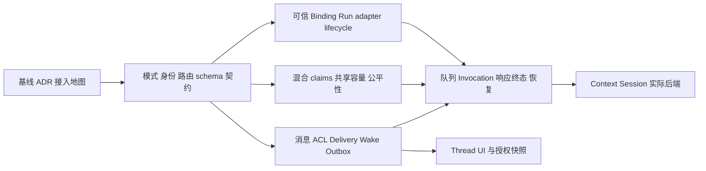

# 持续协作 T01：模式接入盘点与 T02–T04 接口地图

状态：**T01历史盘点快照**；“生产代码、迁移、运行验收均未实施”仅指2026-10-19当时基线。日期：2026-10-19（Asia/Shanghai）。本文是 [实施指导](threaded-collaboration-implementation-guide.md) 的接入附件；验收 ID 继承 [Issue #16](https://github.com/cat15926/agent-gand/issues/16)，下文标记的是**后续验证责任**，不是通过记录。

当前进度已到T12 `b99997a`，见[实施状态](threaded-collaboration-implementation-status.md)和[剩余计划](threaded-collaboration-remaining-plan.md)。本文件的hash与接入责任保留作历史证据，不据此判断当前功能可用性。

基线：`996513c673498811bed894b3eecf64382e71af3f`；盘点 HEAD：`b95dc2553405268a9b807b3983fee8f9facc55fa`。当时仅增加一个 `fix(chat): separate execution drafts and improve result presentation` 提交。当时生产代码没有 `threaded` 实现；RunMode、旧全局锁、Session、终态与恢复核心仍与指南基线相同。新增的 `control_draft` 展示规则必须保留。

## 1. 冻结前提与盘点方法

本轮 T01 的接入前提：内部模式独立命名 `threaded`，产品名“持续协作”；一个 Thread 对应一个 Conversation；使用独立 `threaded_messages`；一个 Invocation 唯一绑定一个执行 Run，可重试失败产生新的 Attempt；单用户安装使用服务端持久 `instance_owner_id`，不采用浏览器 cookie hash 作为数据 owner。[T01 设计决策](threaded-collaboration-t01-decisions.md) 为冻结 ADR 和共享接口的唯一规范，本文只映射接入责任。

证据保存在 [threaded-t01-mode-origin-inventory.json](../reports/evidence/threaded-t01-mode-origin-inventory.json)。该文件记录 HEAD、基线、全部扫描文件及 SHA-256、每组正则、逐行命中、补充入口、候选文件归属及检查局限。源码发生变化后应重新盘点，不把本文件的行号永久视为有效。

搜索范围是 `apps/server/src`、`apps/web/src`、`packages/shared/src` 中由 `rg --files` 枚举的 `.ts/.tsx/.js/.jsx/.mjs/.cjs/.sql` 文件；排除 docs、scripts、测试脚本、构建输出、依赖、运行数据库与配置秘密。共 **296 个生产文件**。全量候选搜索覆盖类型、mode 字段、模式字面量/adapter、origin、旧 Attempt 表、生命周期函数、Run 泛查/更新、最终 else/default、资源边界及 UI 消息投影。10 组共 **1,225 次分类命中、182 个文件**；同一源码行可以命中多组。另显式加入未命中关键词的消息类型、bus、完成判定及 guardian/ownedProcess 等 6 个接入文件。

这是可复查的**文本候选盘点 + 重点调用链人工核对**，不是 AST 穷尽证明或全程序可达性证明。139 条 else/default 候选包含普通解析/文件处理分支；不能全部当作模式错误。相反，没有关键词命中也不能证明不受影响。下表按职责明确“扩展、隔离、复用、无直接改动”边界，附录为每个候选文件提供责任组；后续实现必须通过混合数据库、fake executor 和调用链测试验证，不能以检索数量替代 ISO/Q/REC 验收。

可在仓库根复查原始候选：读取证据中的 `queries`，按 `search.method` 对 `sourceManifest` 的文件逐行匹配；核对文件 hash、每组计数与 `(path,line,text)`。下面的只读脚本不启动应用或供应商调用：

```sh
python3 - <<'PY'
import hashlib, json, re
from pathlib import Path
p = Path('docs/reports/evidence/threaded-t01-mode-origin-inventory.json')
e = json.loads(p.read_text())
assert all(hashlib.sha256(Path(f['path']).read_bytes()).hexdigest() == f['sha256'] for f in e['sourceManifest'])
actual = []
for f in e['sourceManifest']:
    for n, line in enumerate(Path(f['path']).read_text().splitlines(), 1):
        for q in e['queries']:
            if re.search(q['regex'], line):
                actual.append((q['id'], f['path'], n, line))
expected = [(m['query'], m['path'], m['line'], m['text']) for m in e['matches']]
assert sorted(actual) == sorted(expected)
print('source hashes and candidate matches verified; no behavioral acceptance implied')
PY
```

## 2. 按职责接入地图

以下路径均相对仓库根。每组列出当前行为、新模式处理、负责任务包与必须验证的 ID；附录将完整候选文件映射到这些组。一个共享文件可能属于多组，不表示每组都应各自重构它。

| 组 | 现有入口与行为 | threaded 接入要求 | 责任 / 验收 |
| --- | --- | --- | --- |
| S01 共享类型与版本 | `packages/shared/src/run.ts:5,29,58` 三种 RunMode、恢复能力 engine、checkpoint kind；`conversation.ts:16` 复用 RunMode；`execution.ts:4` 三种 ExecutionBinding origin；`orchestration.ts:81,103,148,176`、`coordination.ts:68,210,226,343` 还含 legacy engine/adapter；`events.ts:30` 有 control_draft | 增加独立 threaded 类型、事件、origin 与模式归属；将旧入口参数收窄为 LegacyRunMode，避免扩充 RunMode 后旧 API 自动“支持”新模式。房间模式与执行载体保持明确映射；旧工具版本、HTTP entryVersion、schema 版本互不替代 | T02 主，T03/T09 协作；ISO01–03、DB03、UI01 |
| S02 入场与旧编排隔离 | `conversations/entry.ts:29` 固定 collaboration；`orchestration/entry.ts:201` entryVersion 2 属自主模式；`service.ts:109` 有兼容提交；`normalize.ts:67` 只接受旧三模式；`resolver.ts:189` 选择旧 engine；`capabilities.ts:69` 列 legacyModes；`rolloutPolicy.ts` 控制旧入场 | 注册独立 Threaded API 和开关；旧 submit/preview/resolver/Plan compiler 对 threaded 拒绝并提供稳定错误。不能把 normalize 的白名单简单加入 threaded 后继续编旧计划。新模式关闭入口与旧模式开关无耦合 | T02；ISO01–03、DB01–03、OPS01 |
| S03 身份、HTTP 与 WS | `accounts/access.ts:6,27,63` 内存管理 session、8 小时期限、cookie hash owner、Path=/api/accounts；`api/accountRoutes.ts` 挂管理鉴权；`api/ws.ts:12` 的 /ws 全量转发 bus；旧 API 默认可读 Run/Conversation | 持久 instance_owner_id 与短期访问 session 分开。经已认证 `/api/accounts/threaded/access-session` 签发专用 Path=/api/threaded cookie，不扩大旧 cookie Path。新 HTTP/WS/历史查询校验 Host、Origin、会话及写请求 CSRF；WS 使用 `/api/threaded/ws`，在握手/订阅/重连验证。旧 /ws 和旧读取 API 必须过滤 threaded 及其 Run、trace、execution、附件，不得因共用 bus 泄漏新数据 | T02 HTTP/读隔离，T03 执行身份，T09 客户端；ISO02–04、CTX01–02、UI01 |
| S04 房间、消息与投影 | `conversations/service.ts:90,114` 默认 legacyRoomPreferences；159 行 MAX(turn_no)+1；`messaging/inbox.ts:76` 由 Run 找 Conversation；`message.ts:29`、`db/schema.sql:217` 强制 runId；`messaging/history.ts`、`access.ts` 按旧表读取；`bus.ts:19` 仅进程内提交后通知 | 独立 threaded_messages，不虚构永久 Run。Thread 的身份容器可复用 Conversation，preferences、最新摘要、消息数、history/search/around/replyTo 定位必须按 mode 分流。Threaded 消息 ID 与旧 ID 区分来源。消息/Delivery/Wake/Outbox 原子写入；bus 只是投影提示 | T02 容器与表边界，T05/T06 主；DB01–03、CTX01–04、REC01/04–06、UI01 |
| S05 Run 与生命周期端口 | `runs/trace.ts:136` 创建 Run 冻结账号/成员；265 行泛化状态更新，406 行兼容 finishRun；`runs/recovery.ts:28` 默认走旧协作；`runtime/terminal.ts:115` completed 只认旧 accepted evaluation；`runtime/recovery.ts:56,113` 只读续接/恢复能力按旧模式；`runs/checkpoints.ts` 是 Run checkpoint | 唯一 Invocation↔Run 绑定，同事务分配 turnNo。新增 mode lifecycle port：stop/pause/resume/approval/account revoke/recover/terminal。旧 finishRun/setRunStatus/continuation/graphCheckpoint 对 threaded 拒绝或经端口，不直接改状态。InvocationTerminalProof 在事务中验证；可重试 Attempt 失败不终结 Run；unknown 保持未终态与受控资源 | T03 主，T06 终态；ISO02/04/05、REC02–05、Q06 |
| S06 队列、锁与公平性 | `collaboration/store.ts:182,189,191` 旧全局并发、Agent 排他与 FIFO；`execution/memberAdmission.ts:45,49` 全局队列和 member:agent 租约；`leases.ts:7` owner/host 保护但无单调 generation；`scheduler.ts:992` 容量释放只唤旧队列；`orchestration/ownership.ts` 锁编排器 | 旧 exclusive 与新 thread-slot 共用原子 claim 协调器；不能仅改锁 key。旧独占等待阻止新线程持续插队。并发容量跨所有相关模式统计；claim release/renew 比较 owner+claimId+generation。generation 的持久单调来源不能随释放删除。槽、原生 session、账号与工作区资源分别管理 | T04 主，T03/T06 接入；Q01–06、REC02/03/05、ISO01 |
| S07 可信执行与工具回调 | `execution/authority.ts:45,94,152` 捕获/验证绑定；`agentStep.ts:269,325,843` 绑定、成员入场与工具执行；`runner.ts:113,176,209` driver 准入、周期与回调授权；`policy.ts:17` 旧 RunMode 准入；`bridge.ts:127` bearer + valid() | 新 threaded_invocation_attempt 来源绑定 owner/thread/invocation/attempt/authorityEpoch/slot/fencingToken；从可信 DB 捕获，不接收模型自由字段。新模式无 binding 一律拒绝，堵住 authority.ts:172 的旧无 attempt fallback。执行前、tool 前、原生 callback、输出提交、权限变更后均复验。控制工具、后端准入、输出协议独立于旧 Collaboration | T03 主，T07/T08 接口实现；ISO03–05、Q06、CTX02、REC03/05 |
| S08 Session 与上下文 | `execution/sessions.ts:55,65,71,90` 默认 turn、visibility v1 带 runId、锁 bindingKey、先意图后安全提交；`runtime/context.ts` 是旧摘录；原生 driver 与 parser 定义真实后端能力 | Thread/Agent 稳定策略绑定 + 独立真实 native session ID 锁；绑定包括账号身份代际、模型、工具/权限版本、工作区与宿主。权限收缩或不兼容冷开；增量投递、manifest、delivery/seen/mention ACK 与 unknown 分开。不得关闭旧 ACL 来换连续会话 | T07 主；T03/T04 提供绑定和资源端口；Q04、CTX01–06、REC03/04 |
| S09 模型调用与预算 | `orchestration/executionBudget.ts:29` 只认旧 orchestration snapshot；34 行 deadline 取自主/旧 snapshot/scoped；`modelCalls.ts:14` 自主准入；`costBudget.ts:116` 恢复 pending 预留；`modelCallRecovery.ts:4` 已发请求保留 unknown | Threaded 专属预算授权桥接到公共模型调用、成本和 token 预留；每次重试/Run/后继 wake 继承 causal root，不发一整份新预算。暂停时停发新请求；计费未知与执行未知独立。根设计已冻结全局、Thread、账号初始容量均为 3；T04 实现全模式共享计量，不宣称旧计数器已经满足 | T03 预算凭证、T04 容量、T06/T07 结算；B01–02、REC03/05、Q03/05 |
| S10 旧内核、计划与完成保持 | `collaboration/*`、`coordination/*`、`runtime/taskAdapter.ts`、`coordinationAdapter.ts`、自主/scoped 执行器使用旧 Subject/Custody/dispatch 或冻结图；`completion.ts:14` 失败分支使一次 Run 整体失败；`graphCheckpoint.ts:105` 最后 else 当旧协作 | 新记录不得进入旧 dispatch、consult aggregate、hold、Subject 终态、计划重编或业务续接。保持旧逻辑与回归；公共入口增加拒绝/按模式分派。只抽取实际需要的事务、授权与执行原语，不复制状态机，不把旧能力注册表当 threaded Action 已上线 | T02 隔离、T03 guard、T06/T10 独立状态机；ISO01–05、A02/07、REC05 |
| S11 Evidence、产物、工作区 | `runtime/evidence.ts:112` 等只查旧三类 attempt；`artifacts/store.ts:34`、`snapshots.ts:130` 继承旧执行来源；`workspaces/isolated.ts:67` 依据 Run/旧 workflow 与成员准备工作区；`business.ts:205` 只列旧 attempt 输出 | 明确新来源与 ACL，跨 Run/Thread 引用显式授权；创建执行 Run 不得使新消息通过旧 Evidence 自动变公开。worktree/写互斥与线程槽独立；同一 Invocation 重试的工作区恢复与未知副作用核实。旧领域解析器不自动扩展为新 Action 谓词 | T03 工作区授权、T07/T10/T11 主；CTX02/06、A02/04–07、OS01 |
| S12 前端模式与重连 | `TaskComposer.tsx:20` 旧任务标签，254 行自主/legacy 二选一；`roomDraft.ts:37` 只认旧模式；`collaborationView.ts:26` 只认旧协作运行；`RightPanel.tsx:59` 固定旧协作页签；`store.tsx:394` 初载旧房间+Run/history，555 行始终拉旧协作详情；`services/ws.ts:26` 固定 /ws | 按 Conversation.mode 选择独立 Thread 入口、API、受鉴权 WS 与持久 snapshot。Invocation 完成只收对应流式状态；Action、Thread 不跟随 Run 终态。独立 threaded 消息投影不能塞进强制 runId 的旧 Message；旧草稿迁移不重解释为新模式；取消操作明确单调用/成员/线程范围 | T02 保持可读拒绝/占位，T09 主；UI01、ISO01/02/04、CTX01/02 |
| S13 启动、迁移与运行观测 | `db/database.ts:17,187` WAL/BEGIN IMMEDIATE；`orchestrationMigrations.ts:105` 仅迁旧模式；`index.ts:54` 外部执行→成本→成员→旧任务/协作/恢复；`runs/observability.ts:46,240` 默认 worker/task 等旧分类；`seed.ts` 旧演示 | 数据库版本先校验；旧模式迁移保持原义；新版本写屏障与 rollback/drain 策略先冻结。启动先核实宿主/外部进程与费用，再恢复新 claims、attempts、message/wake/outbox，最后放派发；观测新增 Invocation/Attempt/Thread 与因果 ID。seed 不创建 threaded“演示成功” | T02/T03/T04、T06/T12；DB03、ISO02、REC01–06、OPS01、OS01 |
| X01 关键词旁支 | 文件权限 mode、费用策略 mode、HTTP Origin、账号表单 mode、普通解析 else/default 等 | 保留原语义；本轮没有证据要求为 threaded 改它们。若上游类型/调用者改变仍需复查，不按一次检索把它们列为永久无影响 | 无独立实现包；随所属模块回归 |

## 3. 必须显式替换的 fallback 与隐藏旁路

这是对上表的高风险补充；完整最终 else/default 候选仍在 JSON 中，未把普通控制流冒充模式分派。

| 精确位置 | 当前 fallback / 隐含前提 | 新模式要求 / 验证 |
| --- | --- | --- |
| `conversations/dispatcher.ts:208–216,240,326,338` | 按旧 orchestration snapshot/coordination/旧 mode 调度；非 supervisor 最后走 pipeline；drain 遍历所有 pending Run | 在 dispatch/drain 入场先识别 threaded，拒绝旧路径；不能等待 fallback 后“自然失败”。ISO02 |
| `runs/recovery.ts:32–36,39–43` | plan/fastpath/pipeline/supervisor 以外一律 recoverCollaborationRuns；扫描全部 running/awaiting_approval | mode/origin 路由必须先于旧 checkpoint fallback；threaded 仅新恢复器拥有。ISO02、REC05 |
| `execution/authority.ts:86,99–128,156–173` | 未知 origin fail closed，但 capture 未识别 attempt 会走 task；无 binding 的非旧协作且无 attempt 可 return true | 新模式 mandatory binding；新来源真实表验证，不借旧 fallback。ISO03 |
| `execution/runner.ts:113–117,167` 与 `execution/policy.ts:20` | driver admission 和 runtimeBinding 只认识旧组合 | 显式新能力分支；Binding 成功不等于 driver 已支持。ISO03、OS01 |
| `execution/runner.ts:361–381` 与 `orchestration/agentStep.ts:377` | runner 异常写 failed/cancelled，finally 释放 Session/工作区；agentStep finally 释放成员资源 | T03/T04 在提交状态和 cleanup 前区分确认未启动、确认静止、执行未知、仅费用未知。执行 unknown 保留原 Attempt 的真实 Session/工作区/容量 fence；QuiescenceProof 与副作用对账后才释放。fixture 必须让 runner 抛错而子进程仍存活，证明旧 finally 不能释放后继 claim。REC03、Q06、OS01 |
| `orchestration/actions.ts:35–48,52,66–68` | cancel 关闭旧 dispatch/adapter；pause 是 requestAdapterPause；resume 旧协作或 wakeRun | lifecycle port 联动新 Invocation/Attempt/wake，保留外部退出未确认围栏；Q06、ISO04 |
| `accounts/actions.ts:85–92` | 非 plan/旧 collaboration 落 finishRun；AccountReferences 仅返回 activeRuns | 通过 Run binding 查到 Invocation；撤销后拒绝 queued wake 和旧 callback，已发执行核实后释放。ISO04 |
| `hitl/approvals.ts:89–114`、`api/routes.ts:888–894` | hold 仅查旧 collaboration/coordination attempt；批准后 recoverDurableHolds + wakeRun | 新审批关联当前 Attempt 与授权代际；重启后批准不会走旧恢复器。ISO04、W01/W02 |
| `orchestration/graphCheckpoint.ts:57,105`、`runtime/recovery.ts:56,85,113–121` | 非 plan/pipeline/supervisor 视作旧咨询批次；恢复能力 engine 直接复用 source.mode | threaded 的业务续接/重试有独立合同，旧 checkpoint/continuation 入口明确拒绝。ISO02/03 |
| `packages/shared/src/roomPreferences.ts:23–27`、`conversations/service.ts:90,114` | 非 pipeline 默认为 auto，非 supervisor 为 routine | threaded 创建/更新不调用旧默认映射；不可通过改偏好原地切换执行中的房间。ISO01/02 |
| `orchestration/normalize.ts:67`、`service.ts:156` | mode 被断言成 RunMode，旧 allowlist 负责拒绝 | 新接口独立验证；旧 allowlist 保持 LegacyRunMode，类型扩展不能悄悄扩大入口。ISO03 |
| `runs/trace.ts:265–275,406–419`、`runtime/terminal.ts:115–130` | 泛写 Run 状态、旧 hold/义务回收；completed 需要旧 accepted evaluation | threaded 只经 Invocation 事务端口，终态证明分型；不能调用兼容 finishRun 绕过。ISO05 |
| `execution/memberAdmission.ts:78–122`、`execution/recovery.ts:9–26` | 泛扫 active tickets/inflight sessions；给旧 Run 写 waiting_for_user；所有 inflight sessions 失效 | 先执行模式无关的宿主事实核查，再由唯一模式恢复器处理新记录；未知不重放。REC02/03/05 |
| `collaboration/store.ts:182`、`scheduler.ts:992–998` | 仅数旧 attempts；容量释放只唤旧队列 | 共享容量、fairness 与双向可用通知；新队列也能被旧执行释放唤醒，反之亦然。Q02/03/05 |
| `runs/observability.ts:46–48,231–246`、`runs/failures.ts:50` | 未知 mode 落 worker/task；失败解释只认旧 attempt | 新 Invocation 不显示成 supervisor worker 或旧 Dispatch；失败/unknown 来自实际 attempt。UI01、REC03 |
| `api/ws.ts:17–19`、`api/routes.ts:436–450,460–478` | 旧 /ws 全事件；Conversation、task-state、history/search 无 threaded 边界 | 独立新鉴权路由之外必须隔离旧旁路；包括 Run trace、execution、审批和 artifact 的派生数据。仅在新 UI 隐藏不足以隔离。CTX01/02、ISO02 |
| `store.tsx:394–409,551–555`、`TaskComposer.tsx:254` | 初始加载/重连仍查询旧 Run/history/collaboration；composer 默认 legacy/autonomous | 初始读、深链定位、浏览器刷新和 WS 重连都按模式路由。UI01 |
| `orchestration/turnDisplay.ts:13–15`、`agentStep.ts:584` | 有 controlTools 就是 control_draft；工具轮正文不作正式消息 | Threaded post/final 由新提交器建立消息事实；不可把草稿/流式半个 @ 提前派发。R03、M01、CTX01 |

## 4. T02–T04 共享接口草案

以下名称为拟议接口，不代表已导出 API，也不要求为每项独立建文件。接口由集成负责人统一维护，T03/T04 不各自创建一套 Run/claim/权限类型。

### 4.1 T02：模式、持久身份与存储边界

| 接口 / 数据契约 | 最小职责与限制 | 后续使用者 |
| --- | --- | --- |
| `ThreadedIdentityPort` | 读取 DB 稳定 instance_owner_id；HTTP session 只授予访问，不充当持久 owner；模型参数不能指定 owner | admission、read API、ACL、工具回调 |
| `ThreadedAccessSessionPort` | 在已认证管理路径签发 threaded 范围 cookie/CSRF；核对 Host/Origin；过期/服务重启后的重新认证不改变 Thread owner；明确 logout/revocation 与 WS 关闭行为 | 新 HTTP/WS、前端初次连接/重连 |
| `ThreadedAdmissionPolicy` | `closed/observe/execute`、member/backend allowlist、Thread 状态、版本；关闭新入场与 drain 已接受工作分别控制 | T03 executor、T06 queue、T12 发布 |
| `ThreadRepository` | `conversation_id UNIQUE`，mode/version/owner/authority_epoch；冻结一房间一 Thread；新模式 preferences 与旧默认映射隔离 | T05 message、T06 invocation |
| `InvocationRunBindingRepository` | `invocation_id UNIQUE`、`run_id UNIQUE`；Run.mode=threaded；验证 Conversation/Thread/owner 一致；在同一个 BEGIN IMMEDIATE 中分配 turnNo 和创建 Run | T03 execution adapter |
| `ThreadedMessageRef` / `ThreadedEvent` | 不要求每条消息有 Run；source Invocation/Attempt 可空；显式 owner/thread/audience/causal IDs；事件只在授权流发布，旧 bus 投影不得全量转发 | T05–T09 |
| 数据库兼容元信息 | 记录新模式 schema/protocol/writer 最低版本与迁移校验；保留 `database.ts:15` 在 schema 变更前调用的兼容检查。当前 v24 程序拒绝未知新版本；T02 使用实际下一版本，发布回滚保留兼容 worker 和新数据 | T12 迁移/回滚 |

T02 仅建立最小 Thread/Invocation/Attempt/Run mapping 与后续扩展约束；消息主表与资源表字段由对应任务包一次集成。`CREATE TABLE IF NOT EXISTS` 不足以升级旧列；迁移版本和索引由同一负责人分配。本文不写迁移 SQL。

### 4.2 T03：可信执行与生命周期端口

共享签名以 [T01 设计决策 §11](threaded-collaboration-t01-decisions.md#11-t02-至-t04-的接口草案) 为唯一规范，本文不另定义一套 Scope/Port：

| 规范类型 / 端口 | 本接入地图中的对应职责 |
| --- | --- |
| `ThreadedBinding` | 使用规范中的稳定可信 id、`schemaVersion:1`、`origin:threaded_invocation_attempt`、threadId/invocationId/runId/attemptId、ownerId/agentId/authorityEpoch，以及 claimId、独立 `generation:number`、`fencingToken:string`；不能把 generation 与 token 合并为一个数字 |
| `InvocationExecutionPort.execute` | 接收 binding、contextManifestId、sessionBindingId、budgetAuthorizationId、signal、ScopedExecutionEvent 回调，返回 ExecutionOutcome；复用 agentStep/runner 前后复验绑定 |
| `ThreadedLifecyclePort` | `requestControl` 承担 pause/resume/cancel；`resumeAfterApproval` 处理审批；`revokeAccount` 处理账号撤销；`reconcile` 计划恢复。公共终态提交器另按 InvocationTerminalProof 分派 |

拟议的 `captureThreadedExecutionBinding` 从当前数据库行生成规范绑定，验证 Run mapping、当前 Attempt、member 状态、authorityEpoch、owner、generation、fencingToken 与有效 claim；`assertBindingAuthorized` 必须在公共执行器内识别新 origin。持久保存的 JSON 本身不构成授权，重放时重新查询。

公共 API、账号撤销和启动入口按 mode 调用规范 `ThreadedLifecyclePort`。取消 scope 明确为单 Invocation、Thread 中单成员、整个 Thread 或新入场开关；不得以 stopExternalRun(runId) 代替全部持久状态转移。

`InvocationTerminalProof` 必须携带/引用当前 Attempt、fencing token、已提交输出身份、终态类型、预算结算状态和领域无关的调用完成证据；事务内重新判定。终态事务统一写 Run、Invocation、响应/来源及必要 Outbox，旧 Completion Evaluation 仍只属于旧模式。Action 完成不进入该证明。模型请求已发结果未知时，不伪造 completed/failed 可重试结论。

异常与资源 cleanup 不能沿用旧 runner 的统一失败释放路径。T03 先返回明确 ExecutionOutcome 分类；T04 仅在确认未启动或已有 QuiescenceProof 时允许释放执行资源。执行未知保留真实 Session、工作区和容量围栏；仅费用未知保留费用预留，不扣住已确认静止进程的执行锁。重试、人工继续与 resume 均须遵守同一规则。

**重试边界：**Invocation 与 Run 一对一，因此一个 Attempt 的暂时失败只关闭该 Attempt；新 Attempt 复用未终结的 Run。仅当 Invocation 最终完成/失败/取消才提交 Run 终态。若准备新的 Invocation，则是新的逻辑意图或显式重试关联，必须继承因果链预算，不能通过新 Run 隐式重置。

公共执行器目前会寻找 completed checkpoint/cache；新的 `executionScopeId` 必须含 Invocation/Attempt 或显式恢复锚点，不能让新 Attempt 命中旧 Attempt 的缓存或工具幂等键。恢复同一逻辑调用时哪些 ID 保持、哪些换代由 T06 与 T07 冻结。

### 4.3 T04：混合模式资源 claim

| 接口 | 原子语义 |
| --- | --- |
| `ExecutionResourcesPort.enqueue` | 服务端生成 TrustedResourceRequest：agent/thread/session/account/workspace 资源集合、旧 exclusive 或新 thread-slot 模式、稳定 FIFO 序号；不能由模型传任意资源键 |
| `ExecutionResourcesPort.tryAcquire` | 在同一事务检查旧 exclusive、新 slot、共享容量、等待的旧独占、防饥饿政策和所有资源；成功创建唯一 claimId、单调 generation 和 fencingToken；不在事务中启动模型或等待网络 |
| `ExecutionResourcesPort.heartbeat/release` | 以 ResourceClaimIdentity 比较 claimId、ownerNonce、generation、Attempt；释放还须 QuiescenceProof；旧 finally 无法释放后继；即便进程重启也不重用同一有效代际 |
| `ThreadedLifecyclePort.reconcile` 与释放证明 | 只有持久宿主/外部进程/副作用对账证明满足时调用 release 释放未知占用；租约过期本身不足以重放 |
| 容量释放通知（实现内部协作） | 旧/新队列都能被释放事件唤醒；通知丢失由持久 pending 工作扫描补齐，不能只靠长轮询保证正常调度；不新增第二套公共资源端口 |

资源兼容矩阵：旧×旧独占；旧×新独占；新×新同 Thread/Agent 独占；新×新不同 Thread 可并行但仍受真实 Session、账号/全局容量和工作区约束。旧全局 FIFO 不得继续把所有新 Thread 串起来；新锁也不得绕开已等待旧 exclusive。

实际 session 资源键与策略 bindingKey 不同。若不同 Thread 的 session 绑定错误地指向同一原生 ID，必须由真实 session claim 阻止双 resume（Q04）。根设计已冻结初始全局、Thread、账号容量均为 3，Owner 可显式配置并冻结策略，实际账号/供应商限制更低时取较小值；当前 collaboration_attempts 计数不是所有后端/模式的统一容量。代际来源使用规范 `execution_resource_epochs`，释放 claim 不删除它。

资源 enqueue 前先按根设计准备并 CAS 持久 Session 身份：首批 claude-sdk 可预分配真实 UUID；得到实际 native ID claim 后才启动外部调用。只能在执行后报告 session ID、尚无等价准入保证的后端不得绕过该顺序启用。API reconstructed Session 不宣称具备原生 ID。

## 5. 依赖与集成顺序



1. T02 先冻结 mode/origin、stable owner、Thread/Run/message 身份、旧读取隔离和 schema 最低写版本；编译期与运行时都不能扩大旧入口。
2. T03 与 T04 可并行草拟，但共用 T02 类型；`scope/claimId/generation/authorityEpoch` 字段由集成负责人一次定稿。公共执行器在拿到两者前只接 fake executor，不尝试真实后端。
3. 阶段 1 联合验证 ISO01–05、DB03、Q01–04/Q06，特别包含“审批时重启后批准”“账号撤销后 queued wake”“旧 finally 晚到”“runner 抛错而子进程仍存活，unknown fence 不释放”“threaded 无 binding 调用”与“旧 WS/REST 读取旁路”。
4. T05/T06 完成可靠消息链与 unknown 恢复后，T07 才启用实际 Session。T09 在 T05 数据契约稳定后开发；独立数据加载不能等 UI 最后阶段才补鉴权。
5. 每次添加新 mode/origin、SQL 扫描、lifecycle caller 或公共事件，更新本证据与附录；分包所有者不能把共享 `schema.sql`、`authority.ts`、`agentStep.ts`、`memberAdmission.ts` 各自分叉。

## 6. 检查结果与未决实现事项

本次执行了 AGENTS.md 读取、`squad help`、工作区/HEAD 差异核对、全生产目录关键词/控制流候选搜索、上述关键调用链只读核对。没有启动真实供应商、服务器或运行数据库，没有改生产代码与数据库。文档和证据完整性检查见交接结果；没有任何 ISO/Q/REC/CTX 行为验收被标为通过。

根设计已冻结 Run 对 waiting/unknown 的投影、`execution_resource_epochs` 的单调代际、多资源一次领取、公平轮转和默认容量。T02–T04 按这些规范落实并验证；不再把它们列成待选方案。接口评审仍须核对受保护新 Run 在旧 list/detail/trace/execution/approval/artifact 各出口的过滤职责、访问 session 失效时现有 WS 的关闭/重新鉴权，以及部分底层操作失败时的受控回滚。现有 v24 启动兼容检查必须在迁移前保留并用 fixture 验证，不能由文档已有类型推定行为已通过。

需持续保护的事实：Thread 完成、Invocation 完成和 Action 完成不同；新模式保存用户消息不依赖执行 Run；旧恢复器只有旧记录所有权；执行或副作用未知不能因重试/租约过期被清零；新增鉴权路径不能让旧 REST/WS 成为旁路。

<!-- GENERATED_CANDIDATE_INDEX -->

## 附录：全部候选文件归属

下表由同一次证据采集生成。每个路径的旧行为、新接入要求、责任包及验收由“责任组”对应第 2 节；JSON 的 files 数组亦逐文件保存任务包和验收 ID。这里按文件归属，不把每条宽搜命中都称为缺陷。完整行号/原文/分类见 JSON；无命中但人工加入的入口标为“补充”。

| 文件（锚点为首个命中或补充行） | 责任组 | 处理分类 |
| --- | --- | --- |
| [apps/server/src/accounts/access.ts:14](../../apps/server/src/accounts/access.ts#L14) | S03 | 接入或底座复用候选 |
| [apps/server/src/accounts/actions.ts:6](../../apps/server/src/accounts/actions.ts#L6) | S03, S05 | 接入或底座复用候选 |
| [apps/server/src/accounts/credentials.ts:22](../../apps/server/src/accounts/credentials.ts#L22) | X01 | 关键词旁支，保留原语义 |
| [apps/server/src/accounts/launch.ts:48](../../apps/server/src/accounts/launch.ts#L48) | X01 | 关键词旁支，保留原语义 |
| [apps/server/src/accounts/login.ts:76](../../apps/server/src/accounts/login.ts#L76) | S13 | 接入或底座复用候选 |
| [apps/server/src/accounts/native.ts:25](../../apps/server/src/accounts/native.ts#L25) | S07, S11 | 接入或底座复用候选 |
| [apps/server/src/accounts/relay.ts:21](../../apps/server/src/accounts/relay.ts#L21) | X01 | 关键词旁支，保留原语义 |
| [apps/server/src/accounts/resolver.ts:73](../../apps/server/src/accounts/resolver.ts#L73) | S07, S09 | 接入或底座复用候选 |
| [apps/server/src/accounts/store.ts:43](../../apps/server/src/accounts/store.ts#L43) | S03, S05 | 接入或底座复用候选 |
| [apps/server/src/agents/validation.ts:8](../../apps/server/src/agents/validation.ts#L8) | X01 | 关键词旁支，保留原语义 |
| [apps/server/src/api/accountRoutes.ts:6](../../apps/server/src/api/accountRoutes.ts#L6) | S03, S05 | 接入或底座复用候选 |
| [apps/server/src/api/routes.ts:7](../../apps/server/src/api/routes.ts#L7) | S02, S03, S04, S05 | 接入或底座复用候选 |
| [apps/server/src/api/ws.ts:12](../../apps/server/src/api/ws.ts#L12) | S03, S13 | 接入或底座复用候选 |
| [apps/server/src/artifacts/snapshotFiles.ts:33](../../apps/server/src/artifacts/snapshotFiles.ts#L33) | S11 | 接入或底座复用候选 |
| [apps/server/src/artifacts/snapshotGit.ts:37](../../apps/server/src/artifacts/snapshotGit.ts#L37) | S11 | 接入或底座复用候选 |
| [apps/server/src/artifacts/snapshots.ts:52](../../apps/server/src/artifacts/snapshots.ts#L52) | S11 | 接入或底座复用候选 |
| [apps/server/src/artifacts/store.ts:27](../../apps/server/src/artifacts/store.ts#L27) | S11 | 接入或底座复用候选 |
| [apps/server/src/collaboration/autonomousDelivery.ts:34](../../apps/server/src/collaboration/autonomousDelivery.ts#L34) | S10 | 旧内核边界，隔离并回归 |
| [apps/server/src/collaboration/autonomousEntry.ts:22](../../apps/server/src/collaboration/autonomousEntry.ts#L22) | S10 | 旧内核边界，隔离并回归 |
| [apps/server/src/collaboration/autonomousFlows.ts:19](../../apps/server/src/collaboration/autonomousFlows.ts#L19) | S10 | 旧内核边界，隔离并回归 |
| [apps/server/src/collaboration/autonomousGraph.ts:74](../../apps/server/src/collaboration/autonomousGraph.ts#L74) | S10 | 旧内核边界，隔离并回归 |
| [apps/server/src/collaboration/autonomousRunner.ts:16](../../apps/server/src/collaboration/autonomousRunner.ts#L16) | S07, S10 | 接入或底座复用候选 |
| [apps/server/src/collaboration/controlTools.ts:38](../../apps/server/src/collaboration/controlTools.ts#L38) | S10 | 旧内核边界，隔离并回归 |
| [apps/server/src/collaboration/decisions.ts:15](../../apps/server/src/collaboration/decisions.ts#L15) | S10 | 旧内核边界，隔离并回归 |
| [apps/server/src/collaboration/informationRelease.ts:46](../../apps/server/src/collaboration/informationRelease.ts#L46) | S10 | 旧内核边界，隔离并回归 |
| [apps/server/src/collaboration/protocols/definitions.ts:31](../../apps/server/src/collaboration/protocols/definitions.ts#L31) | S10 | 旧内核边界，隔离并回归 |
| [apps/server/src/collaboration/scheduler.ts:76](../../apps/server/src/collaboration/scheduler.ts#L76) | S06, S10, S13 | 接入或底座复用候选 |
| [apps/server/src/collaboration/scopedDelivery.ts:86](../../apps/server/src/collaboration/scopedDelivery.ts#L86) | S10 | 旧内核边界，隔离并回归 |
| [apps/server/src/collaboration/scopedRunner.ts:13](../../apps/server/src/collaboration/scopedRunner.ts#L13) | S07, S10 | 接入或底座复用候选 |
| [apps/server/src/collaboration/store.ts:1](../../apps/server/src/collaboration/store.ts#L1) | S06, S10 | 接入或底座复用候选 |
| [apps/server/src/config.ts:66](../../apps/server/src/config.ts#L66) | S02, S03 | 接入或底座复用候选 |
| [apps/server/src/conversations/dispatcher.ts:10](../../apps/server/src/conversations/dispatcher.ts#L10) | S02, S05 | 接入或底座复用候选 |
| [apps/server/src/conversations/entry.ts:29](../../apps/server/src/conversations/entry.ts#L29) | S02 | 接入或底座复用候选 |
| [apps/server/src/conversations/service.ts:1](../../apps/server/src/conversations/service.ts#L1) | S04, S03 | 接入或底座复用候选 |
| [apps/server/src/coordination/compiler.ts:186](../../apps/server/src/coordination/compiler.ts#L186) | S10 | 旧内核边界，隔离并回归 |
| [apps/server/src/coordination/evaluation.ts:49](../../apps/server/src/coordination/evaluation.ts#L49) | S10 | 旧内核边界，隔离并回归 |
| [apps/server/src/coordination/externalAdmission.ts:17](../../apps/server/src/coordination/externalAdmission.ts#L17) | S10 | 旧内核边界，隔离并回归 |
| [apps/server/src/coordination/mcpServer.ts:95](../../apps/server/src/coordination/mcpServer.ts#L95) | S10 | 旧内核边界，隔离并回归 |
| [apps/server/src/coordination/modelPlanner.ts:41](../../apps/server/src/coordination/modelPlanner.ts#L41) | S10 | 旧内核边界，隔离并回归 |
| [apps/server/src/coordination/planner.ts:11](../../apps/server/src/coordination/planner.ts#L11) | S10 | 旧内核边界，隔离并回归 |
| [apps/server/src/coordination/protocols.ts:10](../../apps/server/src/coordination/protocols.ts#L10) | S10 | 旧内核边界，隔离并回归 |
| [apps/server/src/coordination/runtime.ts:3](../../apps/server/src/coordination/runtime.ts#L3) | S10 | 旧内核边界，隔离并回归 |
| [apps/server/src/coordination/scopedContext.ts:8](../../apps/server/src/coordination/scopedContext.ts#L8) | S10 | 旧内核边界，隔离并回归 |
| [apps/server/src/coordination/service.ts:108](../../apps/server/src/coordination/service.ts#L108) | S10 | 旧内核边界，隔离并回归 |
| [apps/server/src/coordination/store.ts:13](../../apps/server/src/coordination/store.ts#L13) | S10 | 旧内核边界，隔离并回归 |
| [apps/server/src/coordination/validator.ts:48](../../apps/server/src/coordination/validator.ts#L48) | S10 | 旧内核边界，隔离并回归 |
| [apps/server/src/db/database.ts:107](../../apps/server/src/db/database.ts#L107) | S13 | 接入或底座复用候选 |
| [apps/server/src/db/orchestrationMigrations.ts:3](../../apps/server/src/db/orchestrationMigrations.ts#L3) | S13 | 接入或底座复用候选 |
| [apps/server/src/db/schema.sql:14](../../apps/server/src/db/schema.sql#L14) | S13 | 接入或底座复用候选 |
| [apps/server/src/execution/activityTimeout.ts:53](../../apps/server/src/execution/activityTimeout.ts#L53) | S07 | 接入或底座复用候选 |
| [apps/server/src/execution/authority.ts:1](../../apps/server/src/execution/authority.ts#L1) | S07, S05 | 接入或底座复用候选 |
| [apps/server/src/execution/bridge.ts:127](../../apps/server/src/execution/bridge.ts#L127) | S07 | 接入或底座复用候选 |
| [apps/server/src/execution/drivers.ts:63](../../apps/server/src/execution/drivers.ts#L63) | S07 | 接入或底座复用候选 |
| [apps/server/src/execution/evidence.ts:6](../../apps/server/src/execution/evidence.ts#L6) | S11 | 接入或底座复用候选 |
| [apps/server/src/execution/guardian.mjs:29](../../apps/server/src/execution/guardian.mjs#L29) | S07, S13 | 接入或底座复用候选；补充 |
| [apps/server/src/execution/host.ts:30](../../apps/server/src/execution/host.ts#L30) | S07, S13 | 接入或底座复用候选 |
| [apps/server/src/execution/leases.ts:7](../../apps/server/src/execution/leases.ts#L7) | S06 | 接入或底座复用候选 |
| [apps/server/src/execution/memberAdmission.ts:1](../../apps/server/src/execution/memberAdmission.ts#L1) | S06, S13 | 接入或底座复用候选 |
| [apps/server/src/execution/nativeDrivers.ts:35](../../apps/server/src/execution/nativeDrivers.ts#L35) | S07 | 接入或底座复用候选 |
| [apps/server/src/execution/ownedProcess.ts:17](../../apps/server/src/execution/ownedProcess.ts#L17) | S07, S13 | 接入或底座复用候选；补充 |
| [apps/server/src/execution/parsers.ts:36](../../apps/server/src/execution/parsers.ts#L36) | S07 | 接入或底座复用候选 |
| [apps/server/src/execution/policy.ts:3](../../apps/server/src/execution/policy.ts#L3) | S07 | 接入或底座复用候选 |
| [apps/server/src/execution/preparationFailure.ts:20](../../apps/server/src/execution/preparationFailure.ts#L20) | S07 | 接入或底座复用候选 |
| [apps/server/src/execution/process.ts:83](../../apps/server/src/execution/process.ts#L83) | S07 | 接入或底座复用候选 |
| [apps/server/src/execution/recovery.ts:2](../../apps/server/src/execution/recovery.ts#L2) | S07, S13 | 接入或底座复用候选 |
| [apps/server/src/execution/rpc.ts:52](../../apps/server/src/execution/rpc.ts#L52) | S07 | 接入或底座复用候选 |
| [apps/server/src/execution/runner.ts:30](../../apps/server/src/execution/runner.ts#L30) | S07 | 接入或底座复用候选 |
| [apps/server/src/execution/scopedNativeBudget.ts:37](../../apps/server/src/execution/scopedNativeBudget.ts#L37) | S09 | 接入或底座复用候选 |
| [apps/server/src/execution/sdkOptions.ts:57](../../apps/server/src/execution/sdkOptions.ts#L57) | S07 | 接入或底座复用候选 |
| [apps/server/src/execution/sdkWorker.ts:22](../../apps/server/src/execution/sdkWorker.ts#L22) | S07 | 接入或底座复用候选 |
| [apps/server/src/execution/sessions.ts:9](../../apps/server/src/execution/sessions.ts#L9) | S08 | 接入或底座复用候选 |
| [apps/server/src/execution/store.ts:36](../../apps/server/src/execution/store.ts#L36) | S07, S13 | 接入或底座复用候选 |
| [apps/server/src/hitl/approvals.ts:89](../../apps/server/src/hitl/approvals.ts#L89) | S05 | 接入或底座复用候选 |
| [apps/server/src/index.ts:14](../../apps/server/src/index.ts#L14) | S13, S03 | 接入或底座复用候选 |
| [apps/server/src/llm/provider.ts:266](../../apps/server/src/llm/provider.ts#L266) | X01 | 关键词旁支，保留原语义 |
| [apps/server/src/messaging/access.ts:35](../../apps/server/src/messaging/access.ts#L35) | S04 | 接入或底座复用候选 |
| [apps/server/src/messaging/bus.ts:19](../../apps/server/src/messaging/bus.ts#L19) | S04 | 接入或底座复用候选；补充 |
| [apps/server/src/messaging/history.ts:34](../../apps/server/src/messaging/history.ts#L34) | S04 | 接入或底座复用候选 |
| [apps/server/src/messaging/inbox.ts:76](../../apps/server/src/messaging/inbox.ts#L76) | S04 | 接入或底座复用候选 |
| [apps/server/src/messaging/tasks.ts:307](../../apps/server/src/messaging/tasks.ts#L307) | S10, S13 | 接入或底座复用候选 |
| [apps/server/src/orchestration/actions.ts:12](../../apps/server/src/orchestration/actions.ts#L12) | S05 | 接入或底座复用候选 |
| [apps/server/src/orchestration/agentStep.ts:23](../../apps/server/src/orchestration/agentStep.ts#L23) | S07, S06, S08 | 接入或底座复用候选 |
| [apps/server/src/orchestration/business.ts:116](../../apps/server/src/orchestration/business.ts#L116) | S10, S11 | 接入或底座复用候选 |
| [apps/server/src/orchestration/businessCheckpoint.ts:56](../../apps/server/src/orchestration/businessCheckpoint.ts#L56) | S10, S11 | 接入或底座复用候选 |
| [apps/server/src/orchestration/businessCheckpointStore.ts:16](../../apps/server/src/orchestration/businessCheckpointStore.ts#L16) | S10, S11 | 接入或底座复用候选 |
| [apps/server/src/orchestration/businessGates.ts:26](../../apps/server/src/orchestration/businessGates.ts#L26) | S10 | 旧内核边界，隔离并回归 |
| [apps/server/src/orchestration/businessRecovery.ts:51](../../apps/server/src/orchestration/businessRecovery.ts#L51) | S10, S11 | 接入或底座复用候选 |
| [apps/server/src/orchestration/businessStageExecution.ts:22](../../apps/server/src/orchestration/businessStageExecution.ts#L22) | S10 | 旧内核边界，隔离并回归 |
| [apps/server/src/orchestration/capabilities.ts:69](../../apps/server/src/orchestration/capabilities.ts#L69) | S02 | 接入或底座复用候选 |
| [apps/server/src/orchestration/continuation.ts:68](../../apps/server/src/orchestration/continuation.ts#L68) | S10 | 旧内核边界，隔离并回归 |
| [apps/server/src/orchestration/costBudget.ts:41](../../apps/server/src/orchestration/costBudget.ts#L41) | S09 | 接入或底座复用候选 |
| [apps/server/src/orchestration/costPolicy.ts:13](../../apps/server/src/orchestration/costPolicy.ts#L13) | S09 | 接入或底座复用候选 |
| [apps/server/src/orchestration/entry.ts:60](../../apps/server/src/orchestration/entry.ts#L60) | S02, S03 | 接入或底座复用候选 |
| [apps/server/src/orchestration/executionBudget.ts:19](../../apps/server/src/orchestration/executionBudget.ts#L19) | S09 | 接入或底座复用候选 |
| [apps/server/src/orchestration/graphCheckpoint.ts:31](../../apps/server/src/orchestration/graphCheckpoint.ts#L31) | S05, S10 | 接入或底座复用候选 |
| [apps/server/src/orchestration/modelCallRecovery.ts:11](../../apps/server/src/orchestration/modelCallRecovery.ts#L11) | S09, S13 | 接入或底座复用候选 |
| [apps/server/src/orchestration/modelCalls.ts:18](../../apps/server/src/orchestration/modelCalls.ts#L18) | S09 | 接入或底座复用候选 |
| [apps/server/src/orchestration/normalize.ts:8](../../apps/server/src/orchestration/normalize.ts#L8) | S02 | 接入或底座复用候选 |
| [apps/server/src/orchestration/ownership.ts:1](../../apps/server/src/orchestration/ownership.ts#L1) | S06 | 接入或底座复用候选 |
| [apps/server/src/orchestration/pipeline.ts:8](../../apps/server/src/orchestration/pipeline.ts#L8) | S10 | 旧内核边界，隔离并回归 |
| [apps/server/src/orchestration/recoveryWorkspace.ts:21](../../apps/server/src/orchestration/recoveryWorkspace.ts#L21) | S10, S11 | 接入或底座复用候选 |
| [apps/server/src/orchestration/resolver.ts:48](../../apps/server/src/orchestration/resolver.ts#L48) | S02 | 接入或底座复用候选 |
| [apps/server/src/orchestration/rolloutPolicy.ts:4](../../apps/server/src/orchestration/rolloutPolicy.ts#L4) | S02 | 接入或底座复用候选 |
| [apps/server/src/orchestration/scheduler.ts:89](../../apps/server/src/orchestration/scheduler.ts#L89) | S10 | 旧内核边界，隔离并回归 |
| [apps/server/src/orchestration/schedulingProjection.ts:21](../../apps/server/src/orchestration/schedulingProjection.ts#L21) | S10 | 旧内核边界，隔离并回归 |
| [apps/server/src/orchestration/service.ts:2](../../apps/server/src/orchestration/service.ts#L2) | S02 | 接入或底座复用候选 |
| [apps/server/src/orchestration/supervisor.ts:7](../../apps/server/src/orchestration/supervisor.ts#L7) | S10 | 旧内核边界，隔离并回归 |
| [apps/server/src/orchestration/turnDisplay.ts:1](../../apps/server/src/orchestration/turnDisplay.ts#L1) | S07, S12 | 接入或底座复用候选 |
| [apps/server/src/orchestration/workflows.ts:106](../../apps/server/src/orchestration/workflows.ts#L106) | S10 | 旧内核边界，隔离并回归 |
| [apps/server/src/runs/checkpoints.ts:1](../../apps/server/src/runs/checkpoints.ts#L1) | S05 | 接入或底座复用候选 |
| [apps/server/src/runs/failures.ts:32](../../apps/server/src/runs/failures.ts#L32) | S05, S13 | 接入或底座复用候选 |
| [apps/server/src/runs/observability.ts:40](../../apps/server/src/runs/observability.ts#L40) | S13 | 接入或底座复用候选 |
| [apps/server/src/runs/recovery.ts:3](../../apps/server/src/runs/recovery.ts#L3) | S05 | 接入或底座复用候选 |
| [apps/server/src/runs/trace.ts:3](../../apps/server/src/runs/trace.ts#L3) | S05, S03 | 接入或底座复用候选 |
| [apps/server/src/runtime/actionCommands.ts:88](../../apps/server/src/runtime/actionCommands.ts#L88) | S05, S10 | 接入或底座复用候选 |
| [apps/server/src/runtime/autonomousExecution.ts:32](../../apps/server/src/runtime/autonomousExecution.ts#L32) | S09, S10 | 接入或底座复用候选 |
| [apps/server/src/runtime/autonomousInstructions.ts:46](../../apps/server/src/runtime/autonomousInstructions.ts#L46) | S10 | 旧内核边界，隔离并回归 |
| [apps/server/src/runtime/autonomousPolicy.ts:35](../../apps/server/src/runtime/autonomousPolicy.ts#L35) | S09, S10 | 接入或底座复用候选 |
| [apps/server/src/runtime/autonomousResults.ts:43](../../apps/server/src/runtime/autonomousResults.ts#L43) | S10 | 旧内核边界，隔离并回归 |
| [apps/server/src/runtime/autonomousTasks.ts:74](../../apps/server/src/runtime/autonomousTasks.ts#L74) | S10 | 旧内核边界，隔离并回归 |
| [apps/server/src/runtime/capsule.ts:82](../../apps/server/src/runtime/capsule.ts#L82) | S10 | 旧内核边界，隔离并回归 |
| [apps/server/src/runtime/compatibility.ts:49](../../apps/server/src/runtime/compatibility.ts#L49) | S10 | 旧内核边界，隔离并回归 |
| [apps/server/src/runtime/completion.ts:14](../../apps/server/src/runtime/completion.ts#L14) | S10 | 旧内核边界，隔离并回归；补充 |
| [apps/server/src/runtime/completionStore.ts:48](../../apps/server/src/runtime/completionStore.ts#L48) | S10 | 旧内核边界，隔离并回归 |
| [apps/server/src/runtime/context.ts:151](../../apps/server/src/runtime/context.ts#L151) | S08, S10 | 接入或底座复用候选 |
| [apps/server/src/runtime/coordinationAdapter.ts:81](../../apps/server/src/runtime/coordinationAdapter.ts#L81) | S10 | 旧内核边界，隔离并回归 |
| [apps/server/src/runtime/evidence.ts:53](../../apps/server/src/runtime/evidence.ts#L53) | S11, S10 | 接入或底座复用候选 |
| [apps/server/src/runtime/holds.ts:200](../../apps/server/src/runtime/holds.ts#L200) | S10 | 旧内核边界，隔离并回归 |
| [apps/server/src/runtime/loopGuard.ts:44](../../apps/server/src/runtime/loopGuard.ts#L44) | S10 | 旧内核边界，隔离并回归 |
| [apps/server/src/runtime/recovery.ts:56](../../apps/server/src/runtime/recovery.ts#L56) | S05, S10 | 接入或底座复用候选 |
| [apps/server/src/runtime/responsibilitySnapshot.ts:54](../../apps/server/src/runtime/responsibilitySnapshot.ts#L54) | S07, S10 | 接入或底座复用候选 |
| [apps/server/src/runtime/runControls.ts:11](../../apps/server/src/runtime/runControls.ts#L11) | S05, S10 | 接入或底座复用候选 |
| [apps/server/src/runtime/runPolicy.ts:86](../../apps/server/src/runtime/runPolicy.ts#L86) | S10 | 旧内核边界，隔离并回归 |
| [apps/server/src/runtime/scopedCollaboration.ts:58](../../apps/server/src/runtime/scopedCollaboration.ts#L58) | S10 | 旧内核边界，隔离并回归 |
| [apps/server/src/runtime/shadow.ts:340](../../apps/server/src/runtime/shadow.ts#L340) | S10 | 旧内核边界，隔离并回归 |
| [apps/server/src/runtime/subjectCompletion.ts:248](../../apps/server/src/runtime/subjectCompletion.ts#L248) | S10 | 旧内核边界，隔离并回归 |
| [apps/server/src/runtime/subjectContract.ts:24](../../apps/server/src/runtime/subjectContract.ts#L24) | S10 | 旧内核边界，隔离并回归 |
| [apps/server/src/runtime/taskAdapter.ts:11](../../apps/server/src/runtime/taskAdapter.ts#L11) | S10 | 旧内核边界，隔离并回归 |
| [apps/server/src/runtime/terminal.ts:98](../../apps/server/src/runtime/terminal.ts#L98) | S05, S10 | 接入或底座复用候选 |
| [apps/server/src/seed.ts:13](../../apps/server/src/seed.ts#L13) | S13 | 接入或底座复用候选 |
| [apps/server/src/tasks/attempts.ts:47](../../apps/server/src/tasks/attempts.ts#L47) | S10 | 旧内核边界，隔离并回归 |
| [apps/server/src/tools/builtin/index.ts:152](../../apps/server/src/tools/builtin/index.ts#L152) | S07, S11 | 接入或底座复用候选 |
| [apps/server/src/workspaces/isolated.ts:10](../../apps/server/src/workspaces/isolated.ts#L10) | S11 | 接入或底座复用候选 |
| [apps/server/src/workspaces/manager.ts:66](../../apps/server/src/workspaces/manager.ts#L66) | S11 | 接入或底座复用候选 |
| [apps/web/src/App.tsx:14](../../apps/web/src/App.tsx#L14) | S12 | 接入或底座复用候选 |
| [apps/web/src/collaborationView.ts:26](../../apps/web/src/collaborationView.ts#L26) | S12 | 接入或底座复用候选 |
| [apps/web/src/components/AccountActionPanel.tsx:8](../../apps/web/src/components/AccountActionPanel.tsx#L8) | X01 | 关键词旁支，保留原语义 |
| [apps/web/src/components/AccountForm.tsx:17](../../apps/web/src/components/AccountForm.tsx#L17) | X01 | 关键词旁支，保留原语义 |
| [apps/web/src/components/AgentWizard.tsx:31](../../apps/web/src/components/AgentWizard.tsx#L31) | X01 | 关键词旁支，保留原语义 |
| [apps/web/src/components/ApprovalCard.tsx:17](../../apps/web/src/components/ApprovalCard.tsx#L17) | S05, S12 | 接入或底座复用候选 |
| [apps/web/src/components/AutonomousTaskComposer.tsx:36](../../apps/web/src/components/AutonomousTaskComposer.tsx#L36) | S12 | 接入或底座复用候选 |
| [apps/web/src/components/BusinessAcceptancePanel.tsx:54](../../apps/web/src/components/BusinessAcceptancePanel.tsx#L54) | S10, S12 | 接入或底座复用候选 |
| [apps/web/src/components/BusinessContractEditor.tsx:16](../../apps/web/src/components/BusinessContractEditor.tsx#L16) | S10, S12 | 接入或底座复用候选 |
| [apps/web/src/components/CostBudgetPanel.tsx:8](../../apps/web/src/components/CostBudgetPanel.tsx#L8) | S09, S12 | 接入或底座复用候选 |
| [apps/web/src/components/CostPolicyEditor.tsx:10](../../apps/web/src/components/CostPolicyEditor.tsx#L10) | S09, S12 | 接入或底座复用候选 |
| [apps/web/src/components/Markdown.tsx:26](../../apps/web/src/components/Markdown.tsx#L26) | X01 | 关键词旁支，保留原语义 |
| [apps/web/src/components/RightPanel.tsx:59](../../apps/web/src/components/RightPanel.tsx#L59) | S12 | 接入或底座复用候选 |
| [apps/web/src/components/RoleAccountsPanel.tsx:2](../../apps/web/src/components/RoleAccountsPanel.tsx#L2) | X01 | 关键词旁支，保留原语义 |
| [apps/web/src/components/RunSettingsLabel.tsx:4](../../apps/web/src/components/RunSettingsLabel.tsx#L4) | S12 | 接入或底座复用候选 |
| [apps/web/src/components/TaskCard.tsx:9](../../apps/web/src/components/TaskCard.tsx#L9) | S12 | 接入或底座复用候选 |
| [apps/web/src/components/TaskComposer.tsx:20](../../apps/web/src/components/TaskComposer.tsx#L20) | S12 | 接入或底座复用候选 |
| [apps/web/src/components/observe/RunGraphPanel.tsx:54](../../apps/web/src/components/observe/RunGraphPanel.tsx#L54) | S12 | 接入或底座复用候选 |
| [apps/web/src/components/observe/TrajectoryPanel.tsx:23](../../apps/web/src/components/observe/TrajectoryPanel.tsx#L23) | X01 | 关键词旁支，保留原语义 |
| [apps/web/src/components/views/AccountsView.tsx:13](../../apps/web/src/components/views/AccountsView.tsx#L13) | S03, S12 | 接入或底座复用候选 |
| [apps/web/src/components/views/RunView.tsx:12](../../apps/web/src/components/views/RunView.tsx#L12) | S12 | 接入或底座复用候选 |
| [apps/web/src/services/accounts.ts:12](../../apps/web/src/services/accounts.ts#L12) | S03, S12 | 接入或底座复用候选 |
| [apps/web/src/services/api.ts:59](../../apps/web/src/services/api.ts#L59) | S12 | 接入或底座复用候选 |
| [apps/web/src/services/chatLocation.ts:10](../../apps/web/src/services/chatLocation.ts#L10) | S12 | 接入或底座复用候选 |
| [apps/web/src/services/costPolicy.ts:5](../../apps/web/src/services/costPolicy.ts#L5) | S09, S12 | 接入或底座复用候选 |
| [apps/web/src/services/flowReplayPresentation.ts:53](../../apps/web/src/services/flowReplayPresentation.ts#L53) | S10, S12 | 接入或底座复用候选 |
| [apps/web/src/services/historyWindow.ts:20](../../apps/web/src/services/historyWindow.ts#L20) | S12 | 接入或底座复用候选 |
| [apps/web/src/services/roomDraft.ts:4](../../apps/web/src/services/roomDraft.ts#L4) | S12 | 接入或底座复用候选 |
| [apps/web/src/services/ws.ts:29](../../apps/web/src/services/ws.ts#L29) | S12 | 接入或底座复用候选 |
| [apps/web/src/store.tsx:50](../../apps/web/src/store.tsx#L50) | S12 | 接入或底座复用候选 |
| [packages/shared/src/artifacts.ts:7](../../packages/shared/src/artifacts.ts#L7) | S11 | 接入或底座复用候选 |
| [packages/shared/src/autonomousCollaboration.ts:136](../../packages/shared/src/autonomousCollaboration.ts#L136) | S10 | 旧内核边界，隔离并回归 |
| [packages/shared/src/conversation.ts:1](../../packages/shared/src/conversation.ts#L1) | S01 | 接入或底座复用候选 |
| [packages/shared/src/coordination.ts:3](../../packages/shared/src/coordination.ts#L3) | S01 | 接入或底座复用候选 |
| [packages/shared/src/cost.ts:17](../../packages/shared/src/cost.ts#L17) | S09 | 接入或底座复用候选 |
| [packages/shared/src/events.ts:30](../../packages/shared/src/events.ts#L30) | S01 | 接入或底座复用候选 |
| [packages/shared/src/execution.ts:4](../../packages/shared/src/execution.ts#L4) | S01 | 接入或底座复用候选 |
| [packages/shared/src/index.ts:1](../../packages/shared/src/index.ts#L1) | S01 | 接入或底座复用候选；补充 |
| [packages/shared/src/message.ts:27](../../packages/shared/src/message.ts#L27) | S01, S04 | 接入或底座复用候选；补充 |
| [packages/shared/src/orchestration.ts:4](../../packages/shared/src/orchestration.ts#L4) | S01 | 接入或底座复用候选 |
| [packages/shared/src/roomPreferences.ts:3](../../packages/shared/src/roomPreferences.ts#L3) | S01 | 接入或底座复用候选 |
| [packages/shared/src/run.ts:5](../../packages/shared/src/run.ts#L5) | S01 | 接入或底座复用候选 |
| [packages/shared/src/runtime.ts:62](../../packages/shared/src/runtime.ts#L62) | S01, S10 | 接入或底座复用候选 |
| [packages/shared/src/scopedCollaboration.ts:104](../../packages/shared/src/scopedCollaboration.ts#L104) | S10 | 旧内核边界，隔离并回归 |

索引合计：182 个关键词命中文件 + 6 个补充文件 = 188 个路径；全部 296 个扫描文件的 hash 均保存在证据中。
